# Java Concurrency and Multithreading: The Complete Guide (Java 25)

One file, every topic, one mental model: **"Which problem am I solving, and which tool solves it?"**

Every section follows the same simple shape: **What it is, Problem it solves, When to use, When to avoid, Example.**

---

## Table of Contents

- [Part 0. The Master Mental Model](#part-0-the-master-mental-model)
- [Part 1. Foundations](#part-1-foundations)
- [Part 2. Java Memory Model (JMM)](#part-2-java-memory-model-jmm)
- [Part 3. Thread Basics](#part-3-thread-basics)
- [Part 4. Protecting Shared Data (Safety)](#part-4-protecting-shared-data-safety)
- [Part 5. Coordination Tools (Synchronizers)](#part-5-coordination-tools-synchronizers)
- [Part 6. Concurrent Collections](#part-6-concurrent-collections)
- [Part 7. Executors and Thread Pools](#part-7-executors-and-thread-pools)
- [Part 8. Fork/Join and Parallel Streams](#part-8-forkjoin-and-parallel-streams)
- [Part 9. Async Composition: CompletableFuture and Flow](#part-9-async-composition-completablefuture-and-flow)
- [Part 10. Modern Java: Virtual Threads, Structured Concurrency, Scoped Values](#part-10-modern-java-virtual-threads-structured-concurrency-scoped-values)
- [Part 11. Things That Go Wrong (Liveness and Performance)](#part-11-things-that-go-wrong-liveness-and-performance)
- [Part 12. Design Patterns](#part-12-design-patterns)
- [Part 13. Diagnostics and Testing](#part-13-diagnostics-and-testing)
- [Part 14. Master Decision Tables](#part-14-master-decision-tables)
- [Part 15. Topic Coverage Checklist](#part-15-topic-coverage-checklist)

---

# Part 0. The Master Mental Model

## 0.1 The six problems (everything in Java concurrency solves one of these)

| # | Problem in one line | Short name | Main tools |
|---|---|---|---|
| 1 | "I want to do many things at the same time." | **Execution** | `Thread`, executors, `ForkJoinPool`, virtual threads, parallel streams |
| 2 | "Many threads touch the same data and it gets corrupted or stale." | **Safety** | `synchronized`, `volatile`, atomics, locks, immutability, concurrent collections, confinement |
| 3 | "Threads must wait for / signal each other." | **Coordination** | `wait/notify`, `Condition`, `CountDownLatch`, `CyclicBarrier`, `Phaser`, `Semaphore`, `Exchanger`, `BlockingQueue` |
| 4 | "I want to combine results of async work." | **Composition** | `Future`, `CompletableFuture`, `Flow`, structured concurrency |
| 5 | "I need to stop, time out, or shut down cleanly." | **Lifecycle** | `interrupt`, `shutdown`, `Future.cancel`, `orTimeout`, `StructuredTaskScope`, shutdown hooks |
| 6 | "My program hangs or is slow." | **Liveness and speed** | lock ordering, `tryLock`, pool sizing, `LongAdder`, thread dumps, JFR, JMH |

## 0.2 The big map

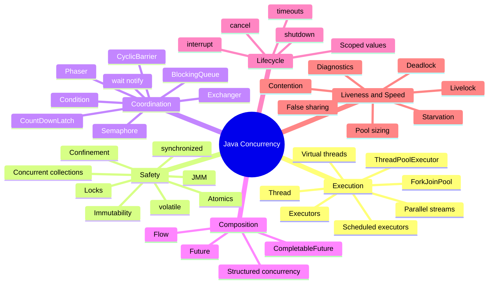

## 0.3 The "which tool?" master flowchart

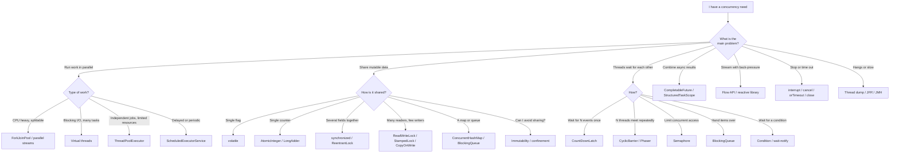

## 0.3a The three-sentence summary

1. **Don't share** (confinement, immutability) is the best fix.
2. **If you must share**, share **immutable** data, or use **thread-safe building blocks** (atomics, concurrent collections).
3. **Only if that is not enough**, use **locks**, and keep them small, ordered and short.

## 0.4 Everyday analogies (use them to remember)

| Concept | Analogy |
|---|---|
| Thread | A worker doing a job |
| Thread pool | A team of workers waiting for jobs |
| Task | A job ticket |
| `synchronized` / Lock | A toilet door key: one person at a time |
| `ReadWriteLock` | A library: many can read, one can rewrite a page, and then nobody reads |
| `volatile` | A whiteboard everyone looks at (always up to date, but no "do two steps safely") |
| Atomic variable | A turnstile counter that clicks safely |
| `Semaphore` | A parking lot with N spaces |
| `CountDownLatch` | A rocket launch: "Go" only after all N checks are green |
| `CyclicBarrier` | A tour group: nobody moves on until everyone has arrived, then repeat |
| `BlockingQueue` | A conveyor belt between cooks and waiters |
| `Future` | A buzzer for your order |
| `CompletableFuture` | A buzzer that also says "then do this next" |
| Deadlock | Two cars on a one-lane bridge, each waiting for the other to back up |
| Livelock | Two people in a corridor both stepping aside, forever |
| Starvation | Someone never gets called from the waiting room |
| Virtual thread | A very cheap "temp worker" who steps aside whenever waiting |

---

# Part 1. Foundations

## 1.1 Key vocabulary

| Term | Simple meaning |
|---|---|
| **Process** | A running program with its own memory. |
| **Thread** | A path of execution **inside** a process. Threads in the same process **share heap memory**. |
| **Concurrency** | Dealing with many things at once (they may take turns on one core). About **structure**. |
| **Parallelism** | Actually running many things at the same instant on many cores. About **speed**. |
| **Asynchrony** | Starting something and **not waiting** for it; you get the result later. |
| **Multithreading** | Using several threads in one program. |
| **Context switch** | The OS pausing one thread and running another (has a cost). |
| **Race condition** | Result depends on timing of threads. |
| **Data race** | Two threads access the same variable, at least one writes, with no ordering between them. |
| **Thread-safe** | Correct no matter how threads are scheduled, with no extra caller coordination. |
| **Critical section** | Code that must not run in two threads at once. |
| **Atomic** | Happens fully or not at all, with nobody seeing the middle. |
| **Visibility** | When one thread writes, will another thread see the new value? |
| **Ordering** | In what order do other threads see the operations? |

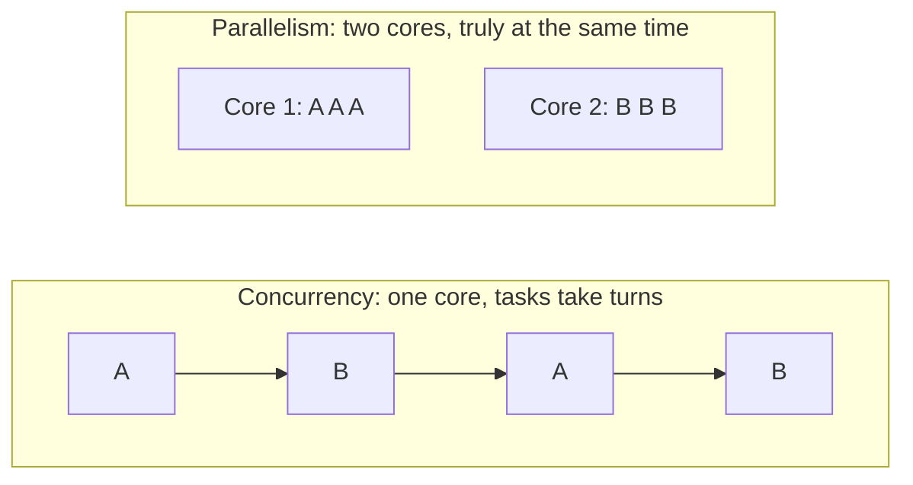

## 1.2 CPU-bound vs I/O-bound (the first decision you always make)

| | CPU-bound | I/O-bound |
|---|---|---|
| Thread is busy doing | calculations | waiting for network, disk, DB |
| Examples | image processing, sorting, encryption, simulation | HTTP calls, SQL queries, file reads |
| Right number of threads | about the number of cores | can be thousands |
| Best tools | `ForkJoinPool`, fixed pool, parallel streams | **virtual threads**, async I/O, `CompletableFuture` with I/O executor |
| Common mistake | too many threads (context switching) | blocking the small common pool |

## 1.3 Amdahl's law (why more threads do not always help)

- If **P** is the fraction of work that can run in parallel and **N** is the number of processors:
  `speedup = 1 / ((1 - P) + P / N)`
- If 10% of the work is sequential, the **maximum** speedup is **10x**, even with infinite cores.
- Lesson: **reduce the sequential part** (locks, shared state, single queue), then add threads.

## 1.4 The three families of concurrency bugs

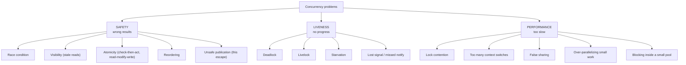

| Family | Question | Typical fix |
|---|---|---|
| Safety | "Is the result ever wrong?" | atomicity + visibility + ordering: locks, atomics, immutability, safe collections |
| Liveness | "Does it always make progress?" | lock ordering, timeouts, fairness, simpler design |
| Performance | "Is it as fast as it should be?" | less sharing, smaller critical sections, right pool size, striping, measuring |

## 1.4a The three properties every shared-data fix must give you

| Property | Meaning | Broken example | Tool that gives it |
|---|---|---|---|
| **Atomicity** | A compound action is indivisible | `count++` loses updates | `synchronized`, `Lock`, atomics |
| **Visibility** | Writes by one thread are seen by others | loop never sees `stop = true` | `volatile`, `synchronized`, `Lock`, atomics, `final` |
| **Ordering** | Other threads see actions in a sensible order | object seen half-constructed | `volatile`, `synchronized`, `Lock`, `final`, happens-before |

> `synchronized` and `Lock` give **all three**. `volatile` gives **visibility and ordering only**. Atomics give **all three for one variable**.

---

# Part 2. Java Memory Model (JMM)

## 2.1 Why the JMM exists

- Each CPU core has **caches** and **registers**. A write might sit there and not reach other cores.
- The compiler and CPU may **reorder** instructions for speed.
- The JMM is the **contract**: "If you follow these rules, you get predictable results."

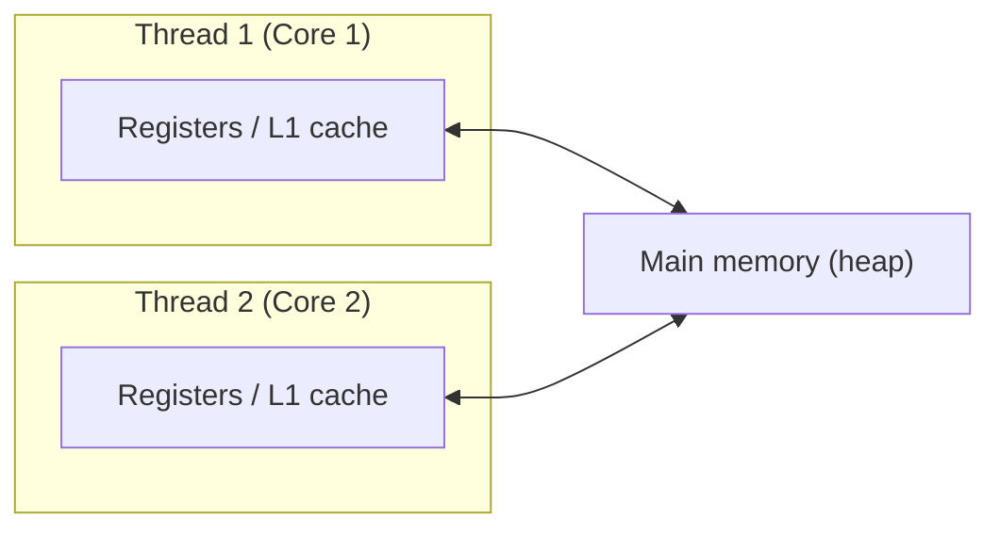

## 2.2 Happens-before (the only rule you really need)

> If action A **happens-before** action B, then everything A did is **visible** to B, and A is **ordered before** B.

| Rule | In plain words |
|---|---|
| Program order | Inside one thread, earlier statements happen-before later ones. |
| Monitor lock | `unlock` of a monitor happens-before every later `lock` of the same monitor. |
| Volatile | A write to a `volatile` happens-before every later read of it. |
| Thread start | `thread.start()` happens-before anything the new thread does. |
| Thread join | Everything a thread did happens-before `join()` returns in another thread. |
| Thread interrupt | `interrupt()` happens-before the interrupted thread detects it. |
| Final fields | Properly constructed object: its `final` fields are visible to all threads without extra sync. |
| Executor submit | Submitting a task happens-before the task starts; the task happens-before `Future.get()` returns. |
| Concurrent collections | Putting an item happens-before another thread getting it. |
| Synchronizers | `countDown()` happens-before `await()` returns; `release()` before `acquire()`; `Lock.unlock()` before `lock()`. |
| `CompletableFuture` | Actions before completing happen-before dependent stages run. |
| Transitivity | If A before B and B before C, then A before C. |

## 2.3 Visibility bug example

```java
class Broken {
    private boolean stop = false;                 // NOT volatile

    void worker() {
        while (!stop) { /* spin */ }              // may never see the change (JIT can hoist the read)
        System.out.println("stopped");
    }
    void stopIt() { stop = true; }
}

class Fixed {
    private volatile boolean stop = false;        // volatile: write is visible to the reader
    // same code now works
}
```

## 2.4 Reordering and safe publication

- "Publishing" an object = making it reachable by another thread.
- **Unsafe publication**: another thread may see the reference but **half-initialized fields**.
- **Safe ways to publish**:
  1. Store in a `volatile` field or `AtomicReference`.
  2. Store in a `final` field of a properly constructed object.
  3. Create it **before** starting the thread that uses it.
  4. Store it while holding a lock, and read it while holding the same lock.
  5. Hand it over through a concurrent collection / `BlockingQueue` / `Future`.
- **Do not let `this` escape** in a constructor (starting a thread or registering a listener from the constructor).

```java
// Double-checked locking: volatile is REQUIRED
class Singleton {
    private static volatile Singleton instance;
    static Singleton get() {
        Singleton local = instance;
        if (local == null) {
            synchronized (Singleton.class) {
                local = instance;
                if (local == null) instance = local = new Singleton();
            }
        }
        return local;
    }
}

// Better and simpler: initialization-on-demand holder (class loading is thread-safe)
class Holder {
    private Holder() {}
    private static class H { static final Holder INSTANCE = new Holder(); }
    static Holder get() { return H.INSTANCE; }
}
// Or: enum Singleton { INSTANCE }
```

## 2.5 `long` and `double` tearing

- Writes to non-volatile `long` / `double` **may be split into two 32-bit writes** on some JVMs. Use `volatile`, atomics, or locks if shared.

## 2.6 Memory barriers (what is happening underneath)

- A **barrier/fence** stops the CPU/compiler from moving operations across it.
- `volatile` write = "release" (everything before is visible), `volatile` read = "acquire" (everything after sees it).
- `VarHandle` lets you pick weaker/stronger modes (see Part 4).

---

# Part 3. Thread Basics

## 3.1 Thread lifecycle

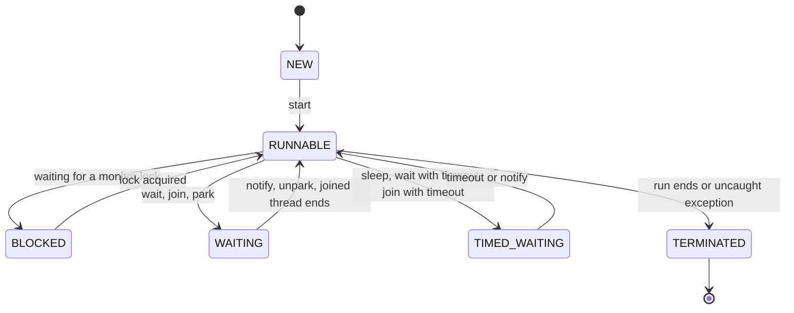

| State | Meaning |
|---|---|
| `NEW` | Created, not started |
| `RUNNABLE` | Running or ready to run (also: doing blocking I/O at OS level) |
| `BLOCKED` | Waiting to enter a `synchronized` block |
| `WAITING` | Waiting with no timeout (`wait()`, `join()`, `LockSupport.park()`, `Lock.lock()` parks) |
| `TIMED_WAITING` | Waiting with timeout (`sleep`, `wait(ms)`, `tryLock(t)`) |
| `TERMINATED` | Finished |

## 3.2 Creating threads (all ways)

| Way | Code | Notes |
|---|---|---|
| Extend `Thread` | `class T extends Thread { public void run(){} }` | Ties task to thread; avoid. |
| Implement `Runnable` | `new Thread(runnable).start()` | Task without result. |
| Lambda | `new Thread(() -> work()).start()` | Common. |
| `Callable` + `FutureTask` | `new Thread(new FutureTask<>(callable))` | Task with result and exception. |
| Thread builder (platform) | `Thread.ofPlatform().name("w-", 0).daemon(true).start(r)` | Modern, named, configurable. |
| Thread builder (virtual) | `Thread.ofVirtual().name("v-").start(r)` | Cheap thread. |
| `Thread.startVirtualThread(r)` | one-liner | Virtual. |
| `ThreadFactory` | `Thread.ofVirtual().factory()` | Plug into executors. |
| Executor | `executor.submit(...)` | **Preferred** in real applications. |

```java
void main() throws Exception {
    Runnable task = () -> System.out.println("hi from " + Thread.currentThread().getName());

    Thread a = new Thread(task, "plain-thread");
    a.start();                                        // start(), NOT run()

    Thread b = Thread.ofPlatform().name("platform-1").start(task);
    Thread c = Thread.ofVirtual().name("virtual-1").start(task);

    a.join(); b.join(); c.join();                     // wait until they finish
}
```

> `start()` creates a **new thread** that calls `run()`. Calling `run()` directly just runs it in the **current** thread (a classic mistake). A thread can be started **only once**.

## 3.3 Important `Thread` methods

| Method | What it does | Notes |
|---|---|---|
| `start()` | Begins execution | Once only |
| `run()` | The task body | Do not call directly |
| `join()` / `join(Duration)` | Wait for thread to end | Throws `InterruptedException` |
| `sleep(ms)` / `sleep(Duration)` | Pause current thread | Does **not** release locks |
| `yield()` | Hint: let others run | Rarely useful |
| `interrupt()` | Request stop (sets flag) | Cooperative, not forced |
| `isInterrupted()` | Read flag | Does not clear |
| `Thread.interrupted()` | Read **and clear** flag (static) | Careful |
| `currentThread()` | The calling thread | |
| `setDaemon(true)` | JVM may exit even if it runs | Before `start()` |
| `isVirtual()` | Is it virtual? | |
| `getState()` | Lifecycle state | For diagnostics |
| `threadId()` | Unique id | `getId()` is deprecated |
| `setName()` / `getName()` | Name for logs and dumps | Always name threads |
| `setPriority()` | Hint to scheduler | Not reliable; ignored for virtual threads |
| `holdsLock(obj)` | Does current thread hold monitor | Assertions |
| `Thread.onSpinWait()` | Hint inside busy-wait loops | Rare |
| `setUncaughtExceptionHandler()` | Handle uncaught exceptions | Important in pools |
| `stop()`, `suspend()`, `resume()` | **Removed/unsafe** | Never use |

## 3.4 Interruption (the correct way to cancel)

- `interrupt()` does **not** kill a thread. It sets a flag; blocking methods (`sleep`, `wait`, `join`, `BlockingQueue.take`, `Lock.lockInterruptibly`, `Future.get`) throw `InterruptedException`.
- When you catch `InterruptedException`: **either rethrow it, or restore the flag** with `Thread.currentThread().interrupt()`. Never swallow it silently.
- Long CPU loops should check `Thread.currentThread().isInterrupted()`.

```java
Runnable worker = () -> {
    try {
        while (!Thread.currentThread().isInterrupted()) {
            doSomeWork();
            Thread.sleep(100);                      // throws if interrupted
        }
    } catch (InterruptedException e) {
        Thread.currentThread().interrupt();         // restore the flag
    } finally {
        cleanup();
    }
};
Thread t = Thread.ofPlatform().start(worker);
// later
t.interrupt();
t.join();
```

## 3.5 Daemon vs user threads

- JVM exits when all **user (non-daemon)** threads finish. **Daemon** threads are killed abruptly at exit.
- Use daemon for background helpers (housekeeping), never for work that must finish (writing files).
- Virtual threads are **always daemon**.

## 3.6 Uncaught exceptions

- An exception that escapes `run()` kills **that thread only**; by default it prints a stack trace.
- Set a handler: `Thread.setDefaultUncaughtExceptionHandler(...)` or per thread.
- In executors: `submit()` captures it in the `Future`; `execute()` sends it to the handler.

## 3.7 Thread groups, priorities, shutdown hooks, Timer (legacy but still asked)

| Topic | Fact |
|---|---|
| `ThreadGroup` | Legacy grouping API. Do not use for new code. |
| Priority | 1 to 10, only a hint. Do not rely on it for correctness. |
| `Runtime.getRuntime().addShutdownHook(thread)` | Runs when JVM shuts down (Ctrl+C, `System.exit`). Use for cleanup; keep short; order not guaranteed. |
| `java.util.Timer` / `TimerTask` | Legacy single-thread scheduler. An exception kills the timer. Prefer `ScheduledExecutorService`. |
| `Thread.stop()` | Removed. Use interruption. |

## 3.8 Thread-local state

| Tool | What it does | Use when | Watch out |
|---|---|---|---|
| `ThreadLocal<T>` | Each thread has its own copy | Per-thread non-thread-safe helpers (`SimpleDateFormat`, random), request context | **Leaks in thread pools**: always `remove()` in `finally`. Costly with millions of virtual threads. |
| `InheritableThreadLocal<T>` | Child thread copies parent's value | Rare | Copy cost, confusing with pools |
| `ScopedValue<T>` (final in Java 25) | Immutable value bound for a scope, inherited by structured child threads | Passing request context down a call tree | Read-only; see Part 10 |
| `ThreadLocalRandom` | Fast per-thread random | Random numbers in concurrent code | Do not share instance across threads |

```java
private static final ThreadLocal<StringBuilder> BUF =
    ThreadLocal.withInitial(StringBuilder::new);

void use() {
    try {
        StringBuilder sb = BUF.get();
        sb.setLength(0);
        // ... use sb ...
    } finally {
        BUF.remove();                       // IMPORTANT in pools
    }
}
```

## 3.9 Platform thread vs virtual thread (preview, details in Part 10)

| | Platform thread | Virtual thread |
|---|---|---|
| Backed by | 1 OS thread | Scheduled onto a few OS "carrier" threads |
| Cost | about 1 MB stack, expensive | a few KB, very cheap |
| Count | thousands | millions |
| Pooling | yes | **no, never pool them** |
| Best for | CPU-bound | blocking I/O |

---

# Part 4. Protecting Shared Data (Safety)

## 4.0 The ladder: try the top first

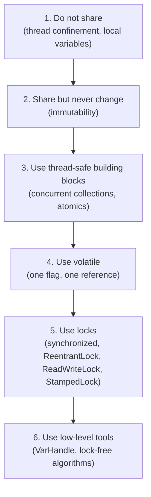

| Technique | Visibility | Atomicity | Blocks threads? | Use for |
|---|---|---|---|---|
| Confinement / immutability | n/a | n/a | No | Default choice |
| `volatile` | Yes | Only single read/write | No | Flags, publish immutable snapshot |
| Atomics (`AtomicInteger`...) | Yes | Yes (one variable) | No (CAS) | Counters, sequence ids, state flags |
| `synchronized` | Yes | Yes (block) | Yes | Simple multi-field invariants |
| `ReentrantLock` | Yes | Yes (block) | Yes | Timeouts, interruptible, `Condition`, fairness |
| `ReadWriteLock` / `StampedLock` | Yes | Yes | Yes | Read-heavy data |
| Concurrent collections | Yes | Per operation | Mostly no | Shared maps, queues, lists |

## 4.1 `synchronized` (intrinsic lock / monitor)

- **What**: Every Java object has a **monitor**. `synchronized` means "take this object's monitor, run, release it".
- **Gives**: mutual exclusion + visibility + ordering (happens-before on unlock/lock).
- **Reentrant**: the same thread can enter again without blocking itself.
- **Automatically released** (even on exception).
- **Cannot**: time out, be interrupted while waiting, be fair, or span methods.

| Form | Locks on |
|---|---|
| `synchronized void m()` | `this` |
| `static synchronized void m()` | `Class` object |
| `synchronized (obj) { ... }` | `obj` |

```java
class Counter {
    private int count;                                  // guarded by this
    public synchronized void inc() { count++; }
    public synchronized int get()  { return count; }
}

class Account {
    private final Object lock = new Object();           // private lock: outsiders cannot interfere
    private long balance;
    void deposit(long x) { synchronized (lock) { balance += x; } }
}
```

Rules:

1. Use the **same lock** for **all** access (read and write) to the same data.
2. Prefer a **private final lock object** over `this`.
3. Keep blocks **short**. Never call unknown code (callbacks, listeners) while holding a lock.
4. Never lock on `String` literals, boxed `Integer`s or a field that changes.
5. Since Java 24 (JEP 491), `synchronized` no longer pins virtual threads in most cases.

## 4.2 `wait()`, `notify()`, `notifyAll()` (guarded blocks)

- **Problem solved**: "wait until a condition becomes true" (for example, queue not empty).
- Must be called **while holding the monitor** (else `IllegalMonitorStateException`).
- `wait()` **releases** the lock and sleeps; on wake-up it **re-acquires** the lock.
- **Always** wait in a **`while` loop** (spurious wakeups, and condition may change before you run).
- Prefer `notifyAll()` unless you are sure only one waiter can proceed.

```java
class SimpleBuffer<T> {
    private final java.util.Queue<T> q = new java.util.ArrayDeque<>();
    private final int cap;
    SimpleBuffer(int cap) { this.cap = cap; }

    public synchronized void put(T x) throws InterruptedException {
        while (q.size() == cap) wait();            // while, never if
        q.add(x);
        notifyAll();
    }
    public synchronized T take() throws InterruptedException {
        while (q.isEmpty()) wait();
        T x = q.remove();
        notifyAll();
        return x;
    }
}
// In real code, use ArrayBlockingQueue instead.
```

## 4.3 `volatile`

- **What**: marks a variable so that every read sees the latest write by any thread, and prevents certain reordering.
- **Does NOT make `count++` atomic** (read, add, write are 3 steps).
- **Use for**: stop flags, "initialized" flags, publishing an **immutable** object, double-checked locking.
- **Do not use for**: counters, check-then-act, invariants over several fields.

```java
private volatile boolean running = true;     // OK: single writer sets, others read
private volatile int counter;                // BAD for counter++
```

## 4.4 Atomic classes (`java.util.concurrent.atomic`) and CAS

- **CAS (compare-and-set)**: "set to NEW only if the current value is still EXPECTED". One CPU instruction. No lock, no blocking.
- Algorithms built on CAS are **lock-free**: some thread always makes progress.

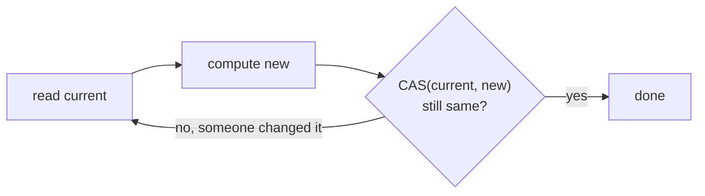

| Class | Purpose |
|---|---|
| `AtomicInteger`, `AtomicLong`, `AtomicBoolean` | Counters, flags |
| `AtomicReference<V>` | Atomically swap an immutable object |
| `AtomicIntegerArray`, `AtomicLongArray`, `AtomicReferenceArray` | Atomic elements of arrays |
| `AtomicStampedReference<V>` | Reference + int stamp (solves **ABA**) |
| `AtomicMarkableReference<V>` | Reference + boolean mark |
| `AtomicIntegerFieldUpdater`, `AtomicLongFieldUpdater`, `AtomicReferenceFieldUpdater` | Atomic ops on a `volatile` field of another class (save memory) |
| `LongAdder`, `DoubleAdder` | High-contention counters/sums (**faster than `AtomicLong`** under load) |
| `LongAccumulator`, `DoubleAccumulator` | Like adders but with your own function (max, min) |

```java
AtomicInteger hits = new AtomicInteger();
hits.incrementAndGet();
hits.updateAndGet(x -> Math.min(x + 1, 100));       // CAS loop done for you
hits.compareAndSet(5, 6);

LongAdder total = new LongAdder();                  // many writers, read rarely
total.add(10);
long sum = total.sum();

AtomicReference<Config> cfg = new AtomicReference<>(Config.defaults());
cfg.updateAndGet(c -> c.withTimeout(500));          // Config must be immutable
```

- **ABA problem**: value goes A, then B, then A again; CAS thinks nothing changed. Fix with `AtomicStampedReference` (version stamp).
- `AtomicLong` vs `LongAdder`: `AtomicLong` when you need the exact value often and contention is low; `LongAdder` for statistics counters with many threads (its `sum()` is not a snapshot).

## 4.5 `VarHandle` (low-level access modes)

- Replacement for `Unsafe`. Gives fine control over memory ordering for expert-level lock-free code.
- Access modes, weakest to strongest: **plain**, **opaque**, **acquire/release**, **volatile**.
- Also offers `compareAndSet`, `getAndAdd`, etc. on fields and array elements.
- Use only in libraries or performance-critical code. Most developers should use atomics.

```java
import java.lang.invoke.*;

class Box {
    volatile int value;
    static final VarHandle VALUE;
    static {
        try { VALUE = MethodHandles.lookup().findVarHandle(Box.class, "value", int.class); }
        catch (ReflectiveOperationException e) { throw new ExceptionInInitializerError(e); }
    }
    boolean cas(int expect, int update) { return VALUE.compareAndSet(this, expect, update); }
}
```

## 4.6 Explicit locks (`java.util.concurrent.locks`)

### 4.6.1 `ReentrantLock`

- Same mutual exclusion as `synchronized` **plus**: `tryLock()`, timed `tryLock(t)`, `lockInterruptibly()`, **fair mode**, multiple **`Condition`s**, `isLocked()`, `getQueueLength()`.
- **You must unlock in `finally`.**

```java
private final ReentrantLock lock = new ReentrantLock();     // new ReentrantLock(true) = fair

void update() {
    lock.lock();
    try {
        // critical section
    } finally {
        lock.unlock();                                       // ALWAYS
    }
}

boolean tryUpdate() throws InterruptedException {
    if (lock.tryLock(200, TimeUnit.MILLISECONDS)) {          // avoid waiting forever
        try { /* work */ return true; }
        finally { lock.unlock(); }
    }
    return false;                                            // could not get the lock
}
```

| | `synchronized` | `ReentrantLock` |
|---|---|---|
| Syntax | block or method | `lock()` / `unlock()` |
| Auto release | Yes | **No** (use `finally`) |
| Try / timeout | No | Yes |
| Interruptible wait | No | Yes (`lockInterruptibly`) |
| Fairness | No | Optional |
| Several condition queues | No (one per object) | Yes (`newCondition()`) |
| Virtual thread pinning | None since Java 24 | None |
| Default choice? | **Yes** (simpler) | When you need the extras |

### 4.6.2 `Condition` (the modern `wait/notify`)

- One lock can have **many** wait-sets (for example, "not full" and "not empty").
- `await()` / `signal()` / `signalAll()`; always in a `while` loop.

```java
class BoundedBuffer<T> {
    private final Lock lock = new ReentrantLock();
    private final Condition notFull  = lock.newCondition();
    private final Condition notEmpty = lock.newCondition();
    private final Object[] items = new Object[10];
    private int putIdx, takeIdx, count;

    void put(T x) throws InterruptedException {
        lock.lock();
        try {
            while (count == items.length) notFull.await();
            items[putIdx] = x; putIdx = (putIdx + 1) % items.length; count++;
            notEmpty.signal();
        } finally { lock.unlock(); }
    }
    @SuppressWarnings("unchecked")
    T take() throws InterruptedException {
        lock.lock();
        try {
            while (count == 0) notEmpty.await();
            T x = (T) items[takeIdx]; takeIdx = (takeIdx + 1) % items.length; count--;
            notFull.signal();
            return x;
        } finally { lock.unlock(); }
    }
}
```

### 4.6.3 `ReadWriteLock` / `ReentrantReadWriteLock`

- **Problem**: many readers, rare writers; readers should not block each other.
- Many readers **or** one writer. Lock downgrading (write to read) is allowed; upgrading is **not** (deadlock).
- Beneficial only when reads are **much more frequent** and read sections are **not tiny**.

```java
private final ReadWriteLock rw = new ReentrantReadWriteLock();
private final Map<String,String> cache = new HashMap<>();

String read(String k) {
    rw.readLock().lock();
    try { return cache.get(k); } finally { rw.readLock().unlock(); }
}
void write(String k, String v) {
    rw.writeLock().lock();
    try { cache.put(k, v); } finally { rw.writeLock().unlock(); }
}
```

### 4.6.4 `StampedLock` (optimistic reads)

- Three modes: **write**, **read**, **optimistic read** (no lock at all, then validate).
- **Not reentrant**, no `Condition`. Fastest for read-mostly, small data.

```java
class Point {
    private double x, y;
    private final StampedLock sl = new StampedLock();

    double distanceFromOrigin() {
        long stamp = sl.tryOptimisticRead();                 // no locking
        double cx = x, cy = y;
        if (!sl.validate(stamp)) {                           // a writer intervened
            stamp = sl.readLock();
            try { cx = x; cy = y; } finally { sl.unlockRead(stamp); }
        }
        return Math.hypot(cx, cy);
    }
    void move(double dx, double dy) {
        long stamp = sl.writeLock();
        try { x += dx; y += dy; } finally { sl.unlockWrite(stamp); }
    }
}
```

### 4.6.5 `LockSupport` (park / unpark)

- The lowest-level blocking primitive used to build locks and synchronizers (`AbstractQueuedSynchronizer`, "AQS", is the base class of `ReentrantLock`, `Semaphore`, `CountDownLatch`, etc.).
- `LockSupport.park()` blocks current thread; `LockSupport.unpark(thread)` wakes it. A permit is not accumulated beyond 1.
- Use only when building your own synchronizer.

### 4.6.6 Lock design tips

- **Lock ordering**: always acquire multiple locks in the **same global order** (prevents deadlock).
- **Lock granularity**: coarse = simple but contended; fine = fast but complex. **Lock striping** = N locks for N buckets (what `ConcurrentHashMap` does).
- **Lock coarsening / elision**: the JIT may merge adjacent locks or remove locks on non-escaping objects.
- **Do not hold locks during I/O** or while calling external code.
- **Fair locks** avoid starvation but lower throughput.

## 4.7 Immutability (the best "synchronization")

- An immutable object **never changes**, so it can be shared freely with no locks.
- Recipe: `final` class, `final` fields, no setters, defensive copies of mutable inputs, no `this` escape.
- Java `record` gives you most of this.
- Updates create a **new** object; publish the new reference with `volatile` or `AtomicReference`.

```java
record Config(int timeoutMs, List<String> hosts) {
    Config { hosts = List.copyOf(hosts); }                  // defensive immutable copy
    Config withTimeout(int t) { return new Config(t, hosts); }
}
private volatile Config config = new Config(500, List.of("a", "b"));   // swap whole snapshot
```

Related: `List.of`, `Map.of`, `Set.of`, `Collections.unmodifiableList` (a **view**, not a copy), `List.copyOf`.

## 4.8 Thread confinement

| Kind | Meaning | Example |
|---|---|---|
| **Stack confinement** | Object only used through local variables, never escapes | Local `StringBuilder` |
| **Thread-local confinement** | Object lives in a `ThreadLocal` | per-thread formatter |
| **Ad hoc confinement** | Convention that only one thread touches it | single event-loop thread, GUI thread |
| **Executor confinement** | A single-thread executor owns the object | `newSingleThreadExecutor()` as a mini "actor" |

## 4.9 Check-then-act and read-modify-write (the two classic race shapes)

```java
// BROKEN check-then-act
if (!map.containsKey(k)) map.put(k, v);            // two threads can both pass the check

// FIXED
map.putIfAbsent(k, v);                              // one atomic call on ConcurrentHashMap
map.computeIfAbsent(k, key -> load(key));

// BROKEN read-modify-write
count++;                                            // read, add, write

// FIXED
atomicCount.incrementAndGet();
```

## 4.10 Lock-free, wait-free, obstruction-free (vocabulary)

| Term | Meaning |
|---|---|
| **Blocking** | A stalled thread (holding a lock) can stop everyone. |
| **Lock-free** | System as a whole always makes progress (CAS retry loops). |
| **Wait-free** | Every thread finishes in a bounded number of steps (rare, hard). |
| **Non-blocking** | Umbrella for lock-free and wait-free styles (`ConcurrentLinkedQueue`, atomics). |

## 4.11 Problem to tool table (Safety)

| Problem | Best fix |
|---|---|
| Thread never sees updated flag | `volatile boolean` |
| Counter loses updates | `AtomicInteger` / `LongAdder` |
| Two fields must change together | `synchronized` / `Lock`, or immutable snapshot in `AtomicReference` |
| Map "check then insert" race | `ConcurrentHashMap.computeIfAbsent` / `merge` |
| Many readers, few writers | `ReadWriteLock`, `StampedLock`, `CopyOnWriteArrayList`, immutable snapshot |
| Need to give up waiting for a lock | `tryLock(timeout)` |
| Object seen half-built | safe publication (`final`, `volatile`, executor, queue) |
| Per-thread helper object | `ThreadLocal` (or create per task) |
| Heavy counter contention | `LongAdder` |

---

# Part 5. Coordination Tools (Synchronizers)

> **Problem**: threads must **wait for each other** or **limit** how many proceed. These classes all live in `java.util.concurrent`.

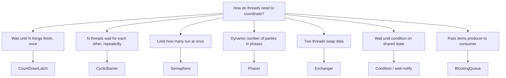

## 5.1 `CountDownLatch`

- **What**: a counter starting at N. `countDown()` decrements; `await()` blocks until it reaches 0. **One-shot** (cannot reset).
- **Use**: "start gate" (all workers begin together) or "end gate" (main waits for N workers).

```java
void main() throws Exception {
    int n = 3;
    var done = new CountDownLatch(n);
    var start = new CountDownLatch(1);

    for (int i = 0; i < n; i++) {
        int id = i;
        Thread.ofPlatform().start(() -> {
            try {
                start.await();                                 // wait for the starting gun
                System.out.println("worker " + id + " working");
            } catch (InterruptedException e) { Thread.currentThread().interrupt(); }
            finally { done.countDown(); }
        });
    }
    start.countDown();                                         // fire the gun
    done.await();                                              // wait for all workers
    System.out.println("all finished");
}
```

## 5.2 `CyclicBarrier`

- **What**: N threads call `await()`; all are released when the Nth arrives. **Reusable**. Optional **barrier action** runs once per round.
- **Use**: iterative parallel algorithms (simulation steps, phases in matrix work).
- If one thread breaks (interrupt, timeout), the barrier is **broken** for everyone (`BrokenBarrierException`).

```java
var barrier = new CyclicBarrier(3, () -> System.out.println("--- round complete ---"));
for (int i = 0; i < 3; i++) {
    Thread.ofPlatform().start(() -> {
        try {
            for (int round = 0; round < 2; round++) {
                // do part of work
                barrier.await();                               // wait for the others
            }
        } catch (Exception e) { Thread.currentThread().interrupt(); }
    });
}
```

| | `CountDownLatch` | `CyclicBarrier` |
|---|---|---|
| Reusable | No | Yes |
| Who counts down | any thread, any number of times | each party calls `await()` |
| Waiters vs counters | different threads can wait and count | the **same** threads wait and arrive |
| Typical | "wait for N tasks" | "N threads move in lockstep" |

## 5.3 `Semaphore`

- **What**: N **permits**. `acquire()` takes one (blocks if none), `release()` returns one.
- **Use**: limit concurrency (DB connections, API rate, parking lot), resource pools. Binary semaphore (N=1) is a lock that **any** thread can release.
- With **virtual threads**, a `Semaphore` is the standard way to cap concurrent access to a scarce resource.

```java
private final Semaphore permits = new Semaphore(10);           // max 10 concurrent calls

String callApi() throws InterruptedException {
    permits.acquire();
    try { return httpCall(); }
    finally { permits.release(); }
}
// tryAcquire(), tryAcquire(timeout), acquire(n), fair mode new Semaphore(10, true)
```

## 5.4 `Phaser`

- **What**: a flexible, reusable barrier with **dynamic parties** (register/deregister) and **phases** (numbered rounds). Can be arranged in a tree.
- **Use**: when the number of participating threads changes, or you need multi-phase workflows.

```java
var phaser = new Phaser(1);                    // register main
for (int i = 0; i < 3; i++) {
    phaser.register();
    Thread.ofPlatform().start(() -> {
        // phase 0 work
        phaser.arriveAndAwaitAdvance();        // everyone finishes phase 0
        // phase 1 work
        phaser.arriveAndDeregister();          // leave
    });
}
phaser.arriveAndAwaitAdvance();                // main joins phase 0
phaser.arriveAndDeregister();
```

## 5.5 `Exchanger<V>`

- **What**: two threads meet at a point and **swap objects**.
- **Use**: double buffering (one thread fills a buffer while another drains the previous one).

```java
Exchanger<List<String>> ex = new Exchanger<>();
// Thread A: List<String> full = ex.exchange(emptyBuffer);   // gives empty, gets full
// Thread B: List<String> empty = ex.exchange(filledBuffer); // gives full, gets empty
```

## 5.6 `Condition` / `wait-notify` / `BlockingQueue` (recap)

- Condition-based waiting on custom state: see 4.2 and 4.6.2.
- Passing work between threads: see Part 6 (`BlockingQueue`). In most cases a queue replaces hand-written wait/notify.

## 5.7 Which synchronizer? (cheat sheet)

| Need | Use |
|---|---|
| "Wait until 5 tasks are done" | `CountDownLatch(5)` |
| "Start everything at the same moment" | `CountDownLatch(1)` as start gate |
| "5 threads must reach a point, then all continue, repeat" | `CyclicBarrier(5)` |
| "Participants join and leave over time, in phases" | `Phaser` |
| "At most 10 at a time" | `Semaphore(10)` |
| "Two threads swap buffers" | `Exchanger` |
| "Wait for custom state, several wait reasons" | `Lock` + several `Condition`s |
| "Producer/consumer" | `BlockingQueue` |
| "Wait for async result" | `Future.get()`, `CompletableFuture.join()` |

---

# Part 6. Concurrent Collections

> **Problem**: normal collections (`ArrayList`, `HashMap`) are **not thread-safe**. Concurrent modification can corrupt them, lose data, or even loop forever.

## 6.1 Options at a glance

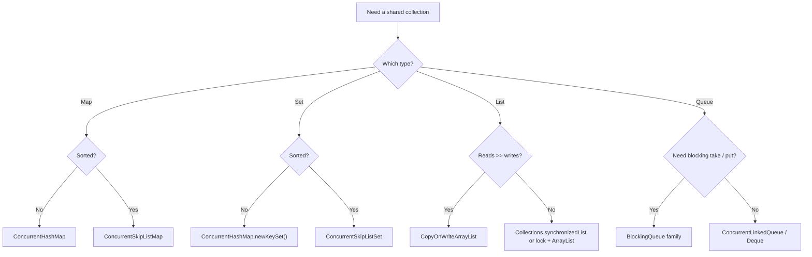

## 6.2 The families

| Family | Classes | Notes |
|---|---|---|
| **Legacy synchronized** | `Vector`, `Hashtable`, `Stack` | One lock for everything. Avoid in new code. |
| **Synchronized wrappers** | `Collections.synchronizedList/Map/Set` | One lock; **iteration must be manually synchronized**; compound ops are not atomic. |
| **Concurrent maps** | `ConcurrentHashMap`, `ConcurrentSkipListMap`, `ConcurrentMap` interface | Fine-grained / lock-free. Best general choice. |
| **Concurrent sets** | `ConcurrentHashMap.newKeySet()`, `ConcurrentSkipListSet`, `CopyOnWriteArraySet` | |
| **Copy-on-write** | `CopyOnWriteArrayList`, `CopyOnWriteArraySet` | Every write copies the array. Great for listener lists and tiny, read-mostly lists. Iterators are **snapshots**. |
| **Non-blocking queues** | `ConcurrentLinkedQueue`, `ConcurrentLinkedDeque` | Lock-free, unbounded. `size()` is O(n). |
| **Blocking queues** | `ArrayBlockingQueue`, `LinkedBlockingQueue`, `LinkedBlockingDeque`, `PriorityBlockingQueue`, `DelayQueue`, `SynchronousQueue`, `LinkedTransferQueue` | Producer/consumer. |

## 6.3 `ConcurrentHashMap` (the most important one)

- Thread-safe, high throughput, **no null keys or values**.
- Use the **atomic compound methods**, not `get` then `put`:

| Method | Does atomically |
|---|---|
| `putIfAbsent(k, v)` | insert if missing |
| `computeIfAbsent(k, fn)` | create value if missing (keep `fn` short and non-blocking; do not modify the map inside it) |
| `computeIfPresent(k, fn)` | update if present |
| `compute(k, fn)` | create or update |
| `merge(k, v, fn)` | combine (great for counting) |
| `replace(k, old, new)`, `remove(k, v)` | conditional update |
| `forEach/reduce/search(parallelism, ...)` | bulk parallel operations |
| `mappingCount()` | size as `long` (approximate under concurrent changes) |

```java
ConcurrentHashMap<String, Integer> wordCount = new ConcurrentHashMap<>();
for (String w : words) wordCount.merge(w, 1, Integer::sum);           // atomic counting

ConcurrentHashMap<String, LongAdder> hist = new ConcurrentHashMap<>();
hist.computeIfAbsent("k", x -> new LongAdder()).increment();          // high-contention counters

Set<String> seen = ConcurrentHashMap.newKeySet();
if (seen.add(id)) { /* first time only */ }
```

- Iterators are **weakly consistent**: they never throw `ConcurrentModificationException` and may or may not show concurrent changes.
- Size and emptiness are estimates while others are modifying.

## 6.4 Fail-fast vs weakly consistent vs snapshot iterators

| Iterator type | Collections | Behaviour when modified during iteration |
|---|---|---|
| **Fail-fast** | `ArrayList`, `HashMap`, `HashSet` | Throws `ConcurrentModificationException` (best effort) |
| **Weakly consistent** | `ConcurrentHashMap`, `ConcurrentLinkedQueue`, skip lists | No exception; may reflect some changes |
| **Snapshot** | `CopyOnWriteArrayList` | Iterates over a frozen copy; never sees changes |

## 6.5 Blocking queues in detail

> **Problem**: producers and consumers run at different speeds. A queue **decouples** them and gives **back-pressure** (bounded queue makes fast producers wait).

| Queue | Bounded? | Order | Special feature | Use for |
|---|---|---|---|---|
| `ArrayBlockingQueue` | Yes (fixed) | FIFO | Single lock, optional fairness | Simple bounded buffer |
| `LinkedBlockingQueue` | Optional (default unbounded) | FIFO | Two locks, higher throughput | Thread pool queues, general producer/consumer |
| `LinkedBlockingDeque` | Optional | FIFO / LIFO | Both ends | Work stealing, stacks |
| `PriorityBlockingQueue` | Unbounded | By priority | Heap | Prioritised tasks |
| `DelayQueue` | Unbounded | By expiry time | Element available only after its delay | Timers, cache expiry, retries |
| `SynchronousQueue` | **Zero capacity** | n/a | Direct hand-off: `put` waits for a `take` | `newCachedThreadPool` internals, direct hand-off |
| `LinkedTransferQueue` | Unbounded | FIFO | `transfer()` waits until consumed | Hand-off + buffering |
| `BlockingDeque` (interface) | | | Double-ended blocking | |

Methods by behaviour:

| | Throws exception | Returns special value | Blocks | Times out |
|---|---|---|---|---|
| Insert | `add(e)` | `offer(e)` | `put(e)` | `offer(e, t, unit)` |
| Remove | `remove()` | `poll()` | `take()` | `poll(t, unit)` |
| Examine | `element()` | `peek()` | n/a | n/a |

```java
void main() throws Exception {
    BlockingQueue<String> q = new ArrayBlockingQueue<>(5);          // bounded = back-pressure
    String POISON = "__STOP__";

    Thread producer = Thread.ofPlatform().start(() -> {
        try {
            for (int i = 0; i < 10; i++) q.put("job-" + i);          // blocks when full
            q.put(POISON);                                          // tell consumer to stop
        } catch (InterruptedException e) { Thread.currentThread().interrupt(); }
    });
    Thread consumer = Thread.ofPlatform().start(() -> {
        try {
            for (String s; !(s = q.take()).equals(POISON); )         // blocks when empty
                System.out.println("processing " + s);
        } catch (InterruptedException e) { Thread.currentThread().interrupt(); }
    });
    producer.join(); consumer.join();
}
```

Shutdown tip: use a **poison pill** value, or interruption, so consumers can stop.

## 6.6 Copy-on-write example

```java
CopyOnWriteArrayList<Listener> listeners = new CopyOnWriteArrayList<>();
listeners.add(l);                                  // write: copies the array (expensive but rare)
for (Listener x : listeners) x.onEvent(e);         // read: lock-free snapshot, safe even if listeners change
```

## 6.7 Other useful classes

- `Collections.synchronizedMap(...)` + manual `synchronized (map) { for (...) }` while iterating.
- `ConcurrentSkipListMap`: sorted, concurrent, `O(log n)`, supports `ceilingKey`, `subMap`.
- Java 21+ **Sequenced collections** (`SequencedCollection`, `reversed()`) are **not** thread-safe by themselves.
- `ThreadLocalRandom.current()` for random numbers; do not share a `java.util.Random` across hot threads.

---

# Part 7. Executors and Thread Pools

> **Problem**: creating a thread per task is costly and unbounded. A **pool** reuses threads, limits concurrency, and separates **what to run** from **how/where to run it**.

## 7.1 Hierarchy (recap)

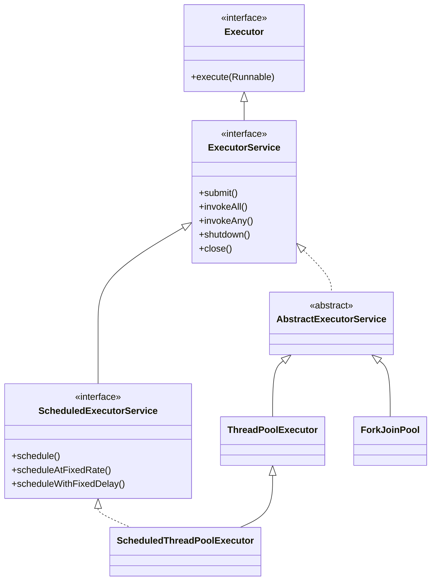

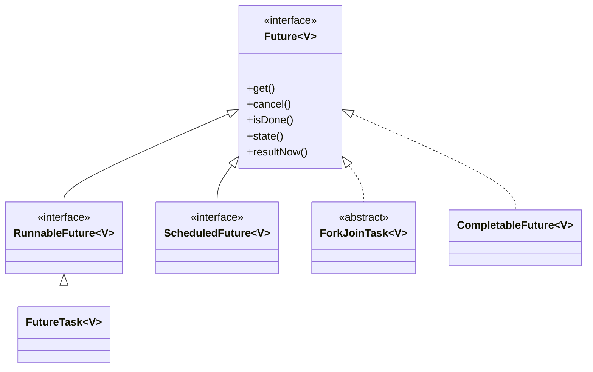

## 7.2 `Runnable`, `Callable`, `Future`, `FutureTask`

| Type | Returns value? | Throws checked exception? | Use |
|---|---|---|---|
| `Runnable` | No | No | Fire-and-forget work |
| `Callable<V>` | Yes | Yes | Work with a result |
| `Future<V>` | handle | | Get result later, cancel, check status |
| `FutureTask<V>` | both `Runnable` and `Future` | | Wrap a `Callable` to run in a thread or pool |

`Future` methods: `get()` (blocks), `get(timeout, unit)`, `cancel(mayInterrupt)`, `isDone()`, `isCancelled()`, and since Java 19: `state()`, `resultNow()`, `exceptionNow()`.

```java
Future<Integer> f = pool.submit(() -> compute());
// do other work ...
try {
    int r = f.get(2, TimeUnit.SECONDS);                  // always prefer a timeout
} catch (TimeoutException e) {
    f.cancel(true);                                       // interrupt the worker
} catch (ExecutionException e) {
    Throwable cause = e.getCause();                       // real exception from the task
}
```

Limits of `Future`: `get()` blocks; cannot chain; cannot combine. That is why `CompletableFuture` exists.

## 7.3 `Executors` factory methods

| Factory | What you get | Danger |
|---|---|---|
| `newFixedThreadPool(n)` | n threads, **unbounded** queue | Queue can grow until `OutOfMemoryError` |
| `newCachedThreadPool()` | Grows as needed, **unbounded threads**, 60 s idle timeout | Thread explosion |
| `newSingleThreadExecutor()` | 1 thread, tasks in order | Unbounded queue; good for confinement |
| `newScheduledThreadPool(n)` | Delayed / periodic tasks | |
| `newSingleThreadScheduledExecutor()` | 1 scheduler thread | |
| `newWorkStealingPool()` | A `ForkJoinPool` (parallelism = cores) | Async mode, not for blocking tasks |
| `newVirtualThreadPerTaskExecutor()` | **New virtual thread per task** | Cap resource use yourself (`Semaphore`) |
| `newThreadPerTaskExecutor(factory)` | New thread per task from a factory | Unbounded |
| `unconfigurableExecutorService(e)` | Wrapper hiding config methods | |

> In production prefer `new ThreadPoolExecutor(...)` with a **bounded queue** and a **rejection policy**.

## 7.4 `ThreadPoolExecutor` in depth

Constructor: `corePoolSize`, `maximumPoolSize`, `keepAliveTime`, `workQueue`, `threadFactory`, `handler`.

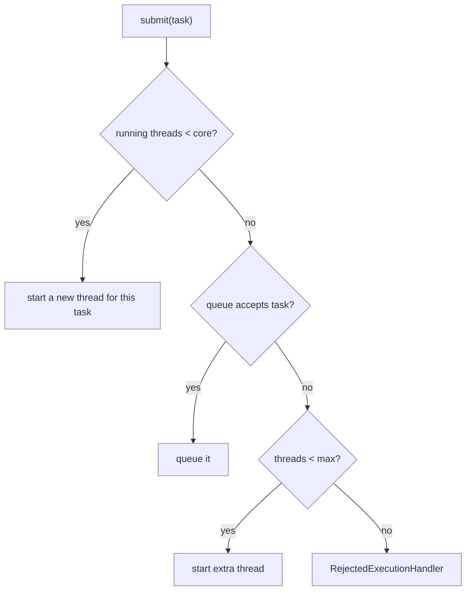

| Queue choice | Effect |
|---|---|
| `SynchronousQueue` | No queueing; grows to max quickly (cached pool) |
| Bounded `ArrayBlockingQueue` / `LinkedBlockingQueue(n)` | Back-pressure, protects memory |
| Unbounded `LinkedBlockingQueue` | `maximumPoolSize` is **never** used; memory risk |
| `PriorityBlockingQueue` | Priority order |

| Rejection policy | Behaviour |
|---|---|
| `AbortPolicy` (default) | Throws `RejectedExecutionException` |
| `CallerRunsPolicy` | The submitting thread runs it (natural back-pressure) |
| `DiscardPolicy` | Silently drops |
| `DiscardOldestPolicy` | Drops oldest queued, retries |
| Custom | Log, persist, or block |

Other knobs: `allowCoreThreadTimeOut(true)`, `prestartAllCoreThreads()`, hooks `beforeExecute`, `afterExecute`, `terminated`, `getActiveCount()`, `getQueue().size()`, `getCompletedTaskCount()` (use for metrics).

## 7.5 How many threads? (pool sizing)

| Work type | Rule of thumb |
|---|---|
| CPU-bound | `cores` or `cores + 1` |
| Blocking (I/O) with platform threads | `cores * (1 + waitTime / computeTime)` |
| Blocking I/O at scale | **Virtual threads** (no sizing needed; cap downstream with `Semaphore`) |
| Mixed | **Separate pools** for CPU and I/O (bulkhead) |

Get cores: `Runtime.getRuntime().availableProcessors()`. Then **measure**.

## 7.6 `execute` vs `submit` vs `invokeAll` vs `invokeAny`

| Method | Waits? | Returns | Notes |
|---|---|---|---|
| `execute(Runnable)` | No | void | Exceptions go to uncaught handler |
| `submit(Runnable/Callable)` | No | `Future` | Exceptions stored in future |
| `invokeAll(tasks)` | Yes (all) | `List<Future>` | All finished when it returns |
| `invokeAny(tasks)` | Yes (first success) | value | Cancels the rest |

## 7.7 `CompletionService` / `ExecutorCompletionService`

- **Problem**: with `invokeAll` you wait for the **slowest**. You want results **as soon as each finishes**.

```java
var cs = new ExecutorCompletionService<String>(pool);
for (Callable<String> t : tasks) cs.submit(t);
for (int i = 0; i < tasks.size(); i++) {
    String r = cs.take().get();           // next finished result, in completion order
}
```

## 7.8 Scheduling

| Method | Meaning |
|---|---|
| `schedule(task, delay, unit)` | Run once after delay |
| `scheduleAtFixedRate(task, initial, period, unit)` | Start times are `period` apart (if a run is slow, next starts immediately after; never concurrent with itself) |
| `scheduleWithFixedDelay(task, initial, delay, unit)` | `delay` between **end** of one run and start of next |

> If a periodic task throws, **future runs are silently cancelled**. Wrap the body in `try/catch`.

```java
var ses = Executors.newScheduledThreadPool(2);
ses.scheduleAtFixedRate(() -> {
    try { heartbeat(); } catch (Exception e) { log(e); }      // never let it escape
}, 0, 5, TimeUnit.SECONDS);
```

## 7.9 Shutting down

| Call | Effect |
|---|---|
| `shutdown()` | No new tasks; queued ones still run |
| `shutdownNow()` | Stops accepting, interrupts workers, returns queued tasks never started |
| `awaitTermination(t, unit)` | Wait for completion |
| `close()` (Java 19+) | `shutdown()` + wait; used by try-with-resources |
| `isShutdown()`, `isTerminated()` | Status |

```java
try (var pool = Executors.newFixedThreadPool(4)) {
    pool.submit(task1);
    pool.submit(task2);
}   // blocks until tasks finish, then shuts down
```

Classic safe shutdown:

```java
pool.shutdown();
if (!pool.awaitTermination(30, TimeUnit.SECONDS)) {
    pool.shutdownNow();
    pool.awaitTermination(10, TimeUnit.SECONDS);
}
```

## 7.10 `ThreadFactory`

```java
ThreadFactory tf = Thread.ofPlatform().name("order-worker-", 1).daemon(false)
    .uncaughtExceptionHandler((t, e) -> log(t.getName(), e)).factory();
var pool = Executors.newFixedThreadPool(8, tf);
```

## 7.11 Common executor mistakes

1. Never shutting the pool down (JVM will not exit).
2. Unbounded queue + slow consumers = `OutOfMemoryError`.
3. Submitting a task that **waits for another task in the same pool** = **thread starvation deadlock**.
4. Ignoring the `Future` returned by `submit` so exceptions disappear.
5. Using one pool for both CPU and I/O work.
6. Forgetting to name threads.

---

# Part 8. Fork/Join and Parallel Streams

> **Problem**: speed up **CPU-bound, divide-and-conquer** work on many cores, with very little scheduling overhead.

## 8.1 Concepts

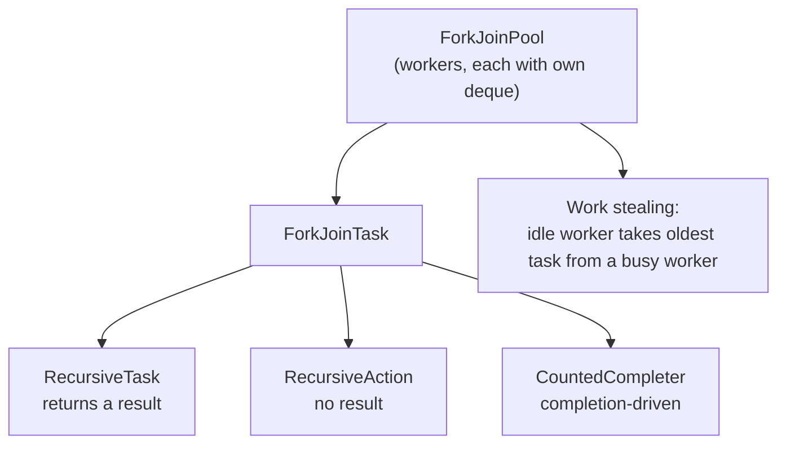

| Item | Meaning |
|---|---|
| `ForkJoinPool` | Pool of workers with **work stealing** |
| `ForkJoinTask<V>` | Lightweight task (implements `Future`) |
| `RecursiveTask<V>` / `RecursiveAction` | Implement `compute()` |
| `fork()` | Schedule asynchronously |
| `join()` | Wait for result |
| `invoke()` | Run here and wait |
| `ForkJoinTask.invokeAll(a, b)` | Fork both, join both |
| `ForkJoinPool.commonPool()` | Shared JVM-wide pool (`availableProcessors() - 1` workers) |
| `new ForkJoinPool(n)` | Your own isolated pool |
| `ManagedBlocker` | Tells the pool a task is about to block, so it can add a worker |
| `CountedCompleter` | Advanced: task completes when pending counter hits 0 |
| `-Djava.util.concurrent.ForkJoinPool.common.parallelism=N` | Tune common pool |

Pattern: **split until small, solve directly, combine**.

```java
class MaxTask extends RecursiveTask<Integer> {
    private static final int THRESHOLD = 10_000;
    private final int[] a; private final int lo, hi;
    MaxTask(int[] a, int lo, int hi) { this.a = a; this.lo = lo; this.hi = hi; }

    @Override protected Integer compute() {
        if (hi - lo <= THRESHOLD) {
            int m = Integer.MIN_VALUE;
            for (int i = lo; i < hi; i++) m = Math.max(m, a[i]);
            return m;
        }
        int mid = (lo + hi) >>> 1;
        var left = new MaxTask(a, lo, mid);
        var right = new MaxTask(a, mid, hi);
        left.fork();                              // async
        int r = right.compute();                  // reuse this thread
        return Math.max(left.join(), r);
    }
}
// int max = ForkJoinPool.commonPool().invoke(new MaxTask(arr, 0, arr.length));
```

## 8.2 The four submit styles (recap)

| Call | Blocks? | Returns | Mental phrase |
|---|---|---|---|
| `invoke(task)` | Yes | `T` | "Run it, I will wait" |
| `invokeAll(callables)` | Yes (all) | `List<Future<T>>` | "Run all, wait for all" |
| `submit(task)` | No | `ForkJoinTask<T>` / `Future` | "Start it, here is a ticket" |
| `execute(task)` | No | void | "Fire and forget" |

## 8.3 Parallel streams

- `list.parallelStream()` or `stream.parallel()` runs the pipeline on the **common ForkJoinPool**.
- Good when: **large** data, **CPU-bound**, **stateless** lambdas, **associative** reductions, **cheap to split** sources (`ArrayList`, arrays, `IntStream.range`).
- Bad when: small data, **I/O or blocking** in lambdas, `LinkedList` / `Stream.iterate`, order-dependent code, shared mutable state, `forEach` mutating a non-thread-safe list.

```java
long count = IntStream.rangeClosed(1, 5_000_000).parallel().filter(Main::isPrime).count();

// WRONG: mutating shared list
List<Integer> out = new ArrayList<>();
list.parallelStream().forEach(out::add);                 // race condition

// RIGHT: let the stream collect
List<Integer> out2 = list.parallelStream().map(x -> x * 2).toList();
```

Terminology: `reduce` needs an **associative** function and an identity; `collect` should be used with concurrent-friendly collectors (`Collectors.toConcurrentMap`, `groupingByConcurrent`).

## 8.4 Other parallel utilities

| API | Purpose |
|---|---|
| `Arrays.parallelSort(a)` | Parallel merge sort for large arrays |
| `Arrays.parallelPrefix(a, fn)` | Parallel cumulative operation |
| `Arrays.parallelSetAll(a, fn)` | Parallel fill |
| `Spliterator` | Defines how a source is split for parallel streams |
| `Executors.newWorkStealingPool()` | Creates a ForkJoinPool as an `ExecutorService` |

## 8.5 ThreadPoolExecutor vs ForkJoinPool (one-line recap)

- **ThreadPoolExecutor**: independent tasks, queue-driven, good for blocking and mixed work.
- **ForkJoinPool**: many small CPU tasks, task-spawns-task, work stealing, avoid blocking.

---

# Part 9. Async Composition: CompletableFuture and Flow

> **Problem**: "Start A and B in parallel, when both finish combine them, if anything fails use a fallback, and **never block a thread waiting**."

## 9.1 `Future` vs `CompletableFuture`

| | `Future` | `CompletableFuture` |
|---|---|---|
| Get result without blocking | No | Yes (callbacks) |
| Chain steps | No | `thenApply`, `thenCompose` |
| Combine several | No | `thenCombine`, `allOf`, `anyOf` |
| Error handling | `ExecutionException` on `get` | `exceptionally`, `handle`, `whenComplete` |
| Complete manually | No | `complete(v)`, `completeExceptionally(e)` |
| Timeouts | `get(timeout)` | `orTimeout`, `completeOnTimeout` |

`CompletableFuture<T>` implements `Future<T>` **and** `CompletionStage<T>`. It is a **promise**: you can create an empty one and complete it later (bridge for callback APIs).

## 9.2 Which thread runs my stage?

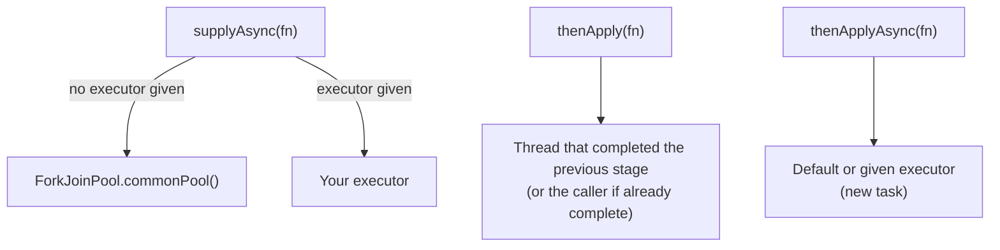

- Common pool has few threads and is meant for **CPU** work. For blocking I/O pass your own executor or a **virtual-thread executor**.

## 9.3 Method cheat sheet

| Goal | Method | Analogy |
|---|---|---|
| Start with value | `supplyAsync(Supplier)` | start a job that returns |
| Start without value | `runAsync(Runnable)` | |
| Already-known value | `completedFuture(v)`, `failedFuture(e)` | |
| Transform result | `thenApply(fn)` | `map` |
| Chain another future | `thenCompose(fn)` | `flatMap` |
| Use result, no return | `thenAccept(consumer)` | |
| Run after, ignore result | `thenRun(runnable)` | |
| Combine two | `thenCombine(other, bifn)` | zip |
| Either one | `applyToEither`, `acceptEither`, `runAfterEither` | |
| Wait for both | `runAfterBoth`, `thenAcceptBoth` | |
| Many futures | `allOf(...)`, `anyOf(...)` | |
| Recover from error | `exceptionally(fn)` | catch |
| Handle value or error | `handle(bifn)` | try/catch/finally returning value |
| Observe, no change | `whenComplete(biconsumer)` | finally |
| Time limit | `orTimeout(t, unit)`, `completeOnTimeout(v, t, unit)` | |
| Delayed start | `CompletableFuture.delayedExecutor(t, unit)` | |
| Get result | `join()` (unchecked), `get()` (checked), `getNow(default)`, `resultNow()` | |
| Manual completion | `complete`, `completeExceptionally`, `obtrudeValue` (avoid) | |
| Variants | every method has `Async` forms and `Async(..., executor)` forms | |

```java
void main() {
    try (var io = Executors.newVirtualThreadPerTaskExecutor()) {
        var user  = CompletableFuture.supplyAsync(() -> loadUser(42), io);
        var cart  = CompletableFuture.supplyAsync(() -> loadCart(42), io);

        String page = user.thenCombine(cart, (u, c) -> render(u, c))       // runs after both
            .orTimeout(2, TimeUnit.SECONDS)
            .exceptionally(ex -> "fallback page")
            .join();
        System.out.println(page);
    }
}

// Sequential dependency: thenCompose (not thenApply, which would give CompletableFuture<CompletableFuture<...>>)
var result = CompletableFuture.supplyAsync(() -> userId(), io)
                              .thenCompose(id -> CompletableFuture.supplyAsync(() -> loadOrders(id), io));

// Fan out, wait for all
var futures = ids.stream().map(id -> CompletableFuture.supplyAsync(() -> fetch(id), io)).toList();
CompletableFuture.allOf(futures.toArray(CompletableFuture[]::new)).join();
List<String> all = futures.stream().map(CompletableFuture::join).toList();
```

## 9.3a Error handling cheat sheet

| Method | Called when | Can change result? |
|---|---|---|
| `exceptionally(ex -> v)` | only on failure | Yes (supplies fallback) |
| `handle((v, ex) -> r)` | success **or** failure | Yes |
| `whenComplete((v, ex) -> ...)` | success **or** failure | No (observer) |

- Exceptions travel downstream wrapped in `CompletionException`. Unwrap with `ex.getCause()`.
- An unobserved failed future is **silent**. Always end a chain with `join`, `get`, `exceptionally` or `whenComplete`.

## 9.4 Pitfalls

1. Blocking calls (`Thread.sleep`, JDBC, HTTP) inside the **common pool** starve everything.
2. Calling `join()`/`get()` inside another async stage can **deadlock** a small pool.
3. `cancel()` does **not** interrupt the running work.
4. Long chains without error handling lose exceptions.
5. Too many `thenApplyAsync` hops create extra context switches.

## 9.5 `Flow` API (Reactive Streams in the JDK)

> **Problem**: producer is faster than consumer, data is a **stream** (not one value), and you need **back-pressure** ("slow down, I can only take N more").

| Interface | Role |
|---|---|
| `Flow.Publisher<T>` | Source of items; `subscribe(subscriber)` |
| `Flow.Subscriber<T>` | Consumer: `onSubscribe`, `onNext`, `onError`, `onComplete` |
| `Flow.Subscription` | Link between them: `request(n)`, `cancel()` |
| `Flow.Processor<T,R>` | Both subscriber and publisher (a transform stage) |
| `SubmissionPublisher<T>` | Ready-made publisher with buffering, uses `ForkJoinPool.commonPool()` by default |

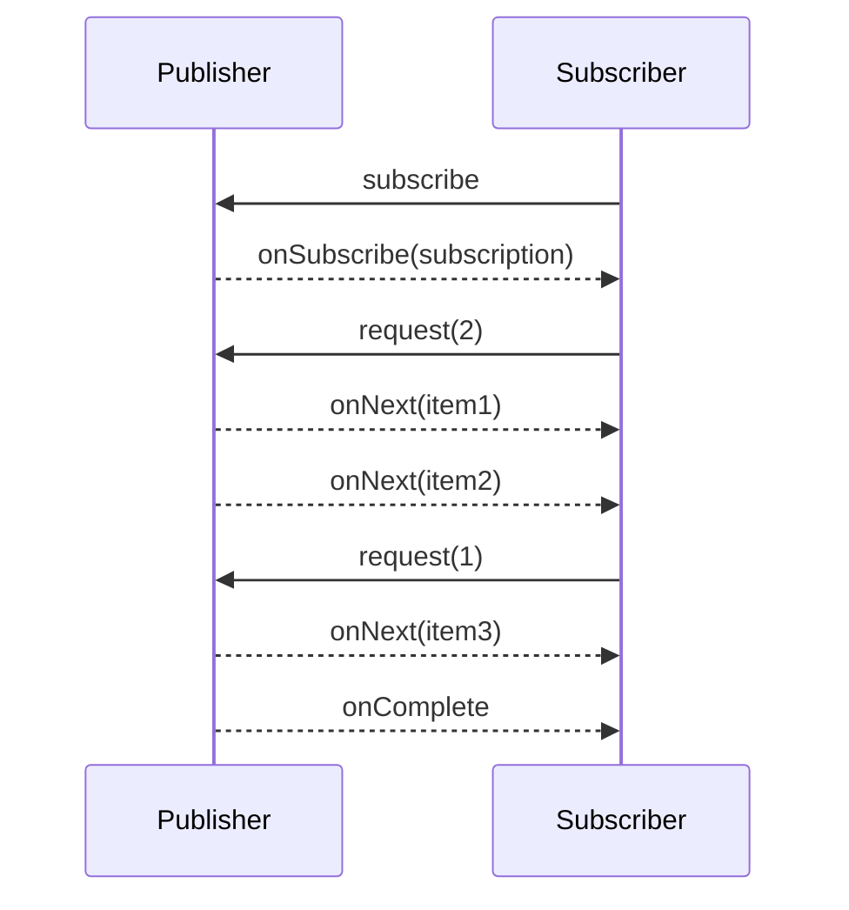

```java
void main() throws Exception {
    try (var pub = new SubmissionPublisher<Integer>()) {
        pub.subscribe(new Flow.Subscriber<>() {
            Flow.Subscription sub;
            public void onSubscribe(Flow.Subscription s) { sub = s; s.request(1); }
            public void onNext(Integer item) { System.out.println("got " + item); sub.request(1); }
            public void onError(Throwable t) { t.printStackTrace(); }
            public void onComplete() { System.out.println("done"); }
        });
        for (int i = 1; i <= 5; i++) pub.submit(i);          // blocks if subscriber buffer is full (back-pressure)
    }
    Thread.sleep(500);
}
```

- The JDK only provides the **interfaces + SubmissionPublisher**. Operators (map, filter, flatMap, retry) come from libraries: **Project Reactor**, **RxJava**, **Akka Streams**.

## 9.6 When to use what (async family)

| Situation | Use |
|---|---|
| One async result, simple | `Future` |
| Pipeline of async steps with fallback | `CompletableFuture` |
| Many concurrent blocking calls, simple code | **Virtual threads** (write plain blocking code) |
| Several subtasks, all-or-nothing, auto cancel | `StructuredTaskScope` (preview in 25) |
| Stream of events with back-pressure | `Flow` / Reactor / RxJava |
| Bridge a callback API | `new CompletableFuture<>()` then `complete(...)` |

---

# Part 10. Modern Java: Virtual Threads, Structured Concurrency, Scoped Values

## 10.1 Virtual threads (final since Java 21)

- **Problem**: blocking I/O with one platform thread per request does not scale (thousands max). Async code scales but is hard to read and debug.
- **Solution**: **cheap threads managed by the JVM**. When a virtual thread blocks (I/O, sleep, lock), it is **unmounted** from its **carrier thread** (a platform thread in a ForkJoinPool), so the carrier can run another virtual thread.

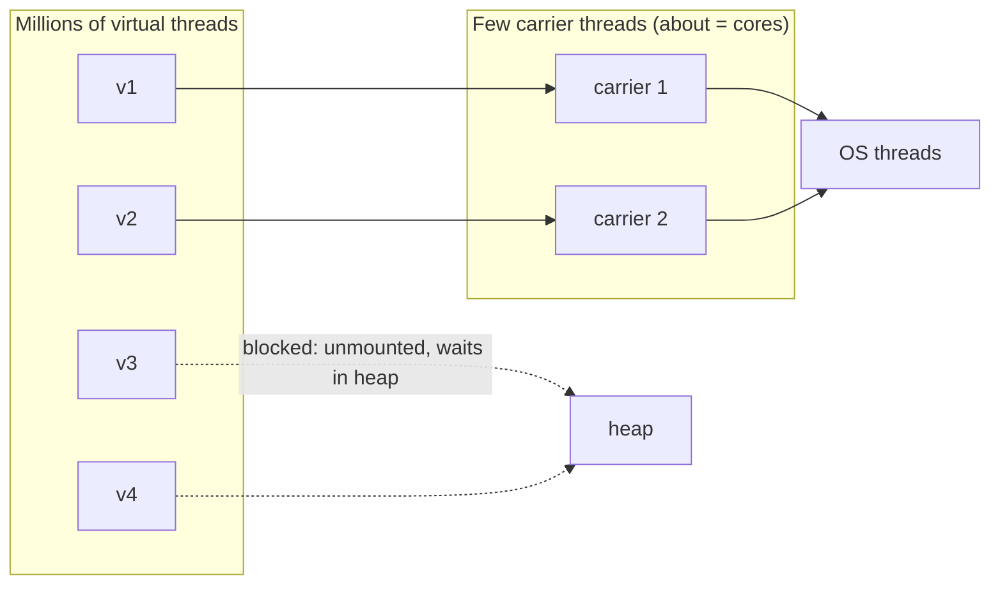

Rules:

| Do | Do not |
|---|---|
| One virtual thread **per task** (`newVirtualThreadPerTaskExecutor()`) | **Pool** virtual threads |
| Write simple **blocking** code | Use virtual threads for CPU-heavy loops (no benefit) |
| Limit scarce resources with `Semaphore` | Assume the thread count limits concurrency (it does not) |
| Use `ReentrantLock` or `synchronized` (Java 24+ no pinning for `synchronized`) | Hold a monitor around a blocking **native** call (can still pin) |
| Prefer `ScopedValue` over heavy `ThreadLocal` | Store big objects in `ThreadLocal` for millions of threads |

```java
void main() throws Exception {
    try (var executor = Executors.newVirtualThreadPerTaskExecutor()) {
        List<Future<String>> fs = new ArrayList<>();
        for (int i = 0; i < 10_000; i++) {
            int id = i;
            fs.add(executor.submit(() -> {
                Thread.sleep(Duration.ofSeconds(1));         // blocks cheaply
                return "task " + id;
            }));
        }
        for (var f : fs) f.get();
    }   // 10,000 tasks finish in about 1 second
}
```

Diagnostics: `jcmd <pid> Thread.dump_to_file -format=json file.json` shows virtual threads; JFR has `jdk.VirtualThreadPinned` events. Useful flags: `-Djdk.tracePinnedThreads` (older JDKs), `-Djdk.virtualThreadScheduler.parallelism=N`.

## 10.2 Platform vs virtual: what to choose

| Workload | Choose |
|---|---|
| Web request handling, DB/HTTP calls, microservices | Virtual threads |
| Heavy computation | Platform threads / `ForkJoinPool` sized to cores |
| Limited resource (DB connections) | Virtual threads + `Semaphore` or connection pool |
| Long-living background jobs needing priorities | Platform threads |

## 10.3 Structured concurrency (`StructuredTaskScope`, preview in Java 25)

- **Problem**: unstructured concurrency (fire threads, hope they finish) leaks threads, loses errors, and makes cancellation hard.
- **Idea**: subtasks live **inside a scope** (like a block of code). The scope does not exit until all subtasks are done or cancelled. Failure of one can cancel the rest. Thread dumps show the parent-child tree.
- **Status**: **preview API** in Java 25 (JEP 505, fifth preview); needs `--enable-preview`. The Java 25 API uses `StructuredTaskScope.open(...)` with a `Joiner`. Check the JEP before depending on it.

```java
// Java 25 with --enable-preview (API may still change)
String loadPage(long id) throws Exception {
    try (var scope = StructuredTaskScope.open()) {                  // default: all must succeed, else cancel
        var user  = scope.fork(() -> loadUser(id));
        var order = scope.fork(() -> loadOrder(id));
        scope.join();                                               // wait; throws if a subtask failed
        return render(user.get(), order.get());
    }
}
```

Run: `java --enable-preview --source 25 Page.java`.

| Pattern | Joiner idea |
|---|---|
| Shut down on first failure (all must succeed) | default `awaitAllSuccessfulOrThrow` |
| First success wins, cancel others | `anySuccessfulResultOrThrow` |
| Collect everything, handle failures yourself | `awaitAll` |

## 10.4 `ScopedValue` (final in Java 25)

- **Problem**: pass context (user, trace id, transaction) down many calls without parameters, and without `ThreadLocal` problems (mutability, leaks, memory with millions of virtual threads).
- **Immutable**, bound for a **scope**, and automatically inherited by structured subtasks.

```java
static final ScopedValue<String> USER = ScopedValue.newInstance();

void handle(Request r) {
    ScopedValue.where(USER, r.user()).run(() -> service());       // bound only inside run()
}
void service() { System.out.println("user = " + USER.get()); }    // read anywhere below
```

| | `ThreadLocal` | `ScopedValue` |
|---|---|---|
| Mutable | Yes | No (rebind in nested scope instead) |
| Lifetime | until `remove()` / thread ends | exactly the scope |
| Leak risk | High in pools | None |
| Cost with many virtual threads | Higher | Low |

## 10.5 Other recent changes worth knowing

| Version | Change |
|---|---|
| 19 | `ExecutorService` is `AutoCloseable`; `Future.resultNow/exceptionNow/state`; `Thread.sleep/join(Duration)` |
| 21 | Virtual threads final; sequenced collections |
| 24 | `synchronized` no longer pins virtual threads (JEP 491) |
| 25 | `ScopedValue` final (JEP 506); structured concurrency still preview (JEP 505); instance `main` / compact source files final (JEP 512) |

---

# Part 11. Things That Go Wrong (Liveness and Performance)

## 11.1 Deadlock

- **Definition**: two or more threads wait **forever** for each other's locks.
- **Needs all four (Coffman) conditions**: mutual exclusion, hold-and-wait, no preemption, circular wait. **Break one** to prevent it.

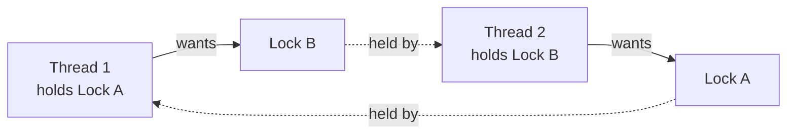

```java
// DEADLOCK: opposite order
void t1() { synchronized (A) { synchronized (B) { ... } } }
void t2() { synchronized (B) { synchronized (A) { ... } } }

// FIX 1: same global order everywhere
void t2fixed() { synchronized (A) { synchronized (B) { ... } } }

// FIX 2: tryLock with timeout and back off
if (lockA.tryLock(100, MILLISECONDS)) try {
    if (lockB.tryLock(100, MILLISECONDS)) try { work(); } finally { lockB.unlock(); }
} finally { lockA.unlock(); }
```

| Prevention | Idea |
|---|---|
| Lock ordering | Break circular wait |
| `tryLock` with timeout | Break hold-and-wait |
| Single coarse lock | Remove second lock |
| Avoid nested locks, avoid calling foreign code under lock | Reduce chance |
| Use higher-level tools (queues, immutable data) | Avoid locks |

Detect: `jstack <pid>` or `jcmd <pid> Thread.print` prints "Found one Java-level deadlock"; `ThreadMXBean.findDeadlockedThreads()` programmatically.

**Thread-starvation deadlock**: all pool threads wait for tasks that are queued in the **same pool**. Fix: separate pools or avoid waiting inside tasks.

## 11.2 Livelock

- Threads are **active but make no progress** (both keep retrying/yielding to each other).
- Fix: randomized back-off, priority/ordering, one thread decides.

## 11.3 Starvation and fairness

- A thread **never gets** CPU or lock because others always win.
- Causes: unfair locks, low priority, long-held locks, one task hogging a pool.
- Fix: fair locks (`new ReentrantLock(true)`), shorter critical sections, bulkhead pools.

## 11.4 Priority inversion

- Low-priority thread holds a lock needed by a high-priority thread, and a medium one keeps the low one from running. Rare in Java; avoid depending on priorities.

## 11.5 Lost wake-up and missed signal

- Calling `notify()` **before** the waiter calls `wait()` and no state variable remembers it. Fix: always keep a **condition variable** (boolean/state) and `while (!cond) wait();`.

## 11.6 Performance problems

| Problem | Symptom | Fix |
|---|---|---|
| **Lock contention** | Threads often `BLOCKED`; low CPU use | Smaller critical sections, striping, `ConcurrentHashMap`, `LongAdder`, immutability |
| **Too many threads** | Context-switch storm, high CPU in kernel | Pool sized to cores for CPU work |
| **Too few threads for I/O** | Low CPU, slow requests | Virtual threads / bigger I/O pool |
| **False sharing** | Independent variables on one cache line slow each other | `@jdk.internal.vm.annotation.Contended` (internal), padding, `LongAdder` (which pads cells) |
| **Over-parallelizing** | Parallel slower than sequential | Measure; bigger threshold; sequential for small work |
| **Blocking in common pool** | Whole app stalls | Own executor |
| **Unbounded queues** | Memory growth, latency | Bounded queue + back-pressure |
| **Memory visibility via too many volatiles** | Slow hot paths | Batch updates, local copies |
| **Thread-local leaks** | Memory grows in pools | `remove()` in `finally` |
| **Thread leaks** | Threads keep growing | Always shut pools down; use try-with-resources |

## 11.7 Safety problems quick table

| Bug | Example | Fix |
|---|---|---|
| Lost update | `count++` from two threads | atomics / lock |
| Stale read | loop never sees flag | `volatile` |
| Check-then-act | `if (!map.containsKey) put` | `putIfAbsent`, `compute` |
| Unsafe publication | other thread sees half-built object | `final`, `volatile`, safe handoff |
| `this` escape | starting thread in constructor | factory method after construction |
| Iterating while modifying | `ConcurrentModificationException` | concurrent collection / snapshot |
| Non-atomic `long` write | torn value | `volatile long` / atomic |
| Shared `SimpleDateFormat` | garbage dates | `DateTimeFormatter` (immutable) |
| Swallowed `InterruptedException` | thread cannot be stopped | rethrow or re-interrupt |

---

# Part 12. Design Patterns

| Pattern | Problem it solves | Java tools |
|---|---|---|
| **Producer-Consumer** | Different production/consumption speeds | `BlockingQueue` (bounded) |
| **Pipeline** | Multi-stage processing, stages in parallel | Queues between stages, or `CompletableFuture` chain |
| **Fan-out / Fan-in** | Split work, then merge results | `invokeAll`, `CompletableFuture.allOf`, `StructuredTaskScope` |
| **Master-Worker (thread pool)** | Many independent jobs | `ExecutorService` |
| **Fork-Join (divide and conquer)** | Recursive CPU work | `ForkJoinPool`, `RecursiveTask` |
| **Thread-per-task / per-request** | Simple blocking code at scale | Virtual threads |
| **Reader-Writer** | Read-mostly shared data | `ReadWriteLock`, `StampedLock`, `CopyOnWriteArrayList` |
| **Immutable snapshot (RCU style)** | Lock-free reads, occasional updates | `volatile` / `AtomicReference` holding an immutable object |
| **Thread confinement / single-writer (actor style)** | Avoid locks entirely | single-thread executor, event loop |
| **Future / Promise** | Handle for a later result | `Future`, `CompletableFuture` |
| **Publish-Subscribe** | Many listeners to events | `Flow`, `SubmissionPublisher`, `CopyOnWriteArrayList` listeners |
| **Bulkhead** | One slow dependency must not take everything down | Separate pools / `Semaphore` per dependency |
| **Rate limiter** | Protect a service | `Semaphore`, token bucket with `ScheduledExecutorService` |
| **Timeout + retry** | Unreliable calls | `orTimeout`, `Future.get(timeout)`, loop with back-off |
| **Circuit breaker** | Stop calling a failing dependency | Library (Resilience4j) or custom with atomics |
| **Double buffering** | Fill one buffer while draining another | `Exchanger` |
| **Lazy initialization holder** | Thread-safe lazy singleton | Holder class idiom, `enum` |
| **Poison pill** | Stop consumers cleanly | Special sentinel in queue |
| **Balking / guarded suspension** | Act only if state allows / wait until it does | `if (!ready) return;` / `Condition` |

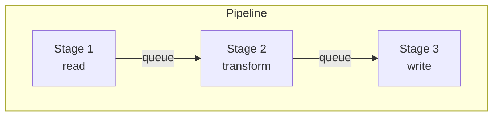

```java
// Fan-out / fan-in with virtual threads and Future
try (var ex = Executors.newVirtualThreadPerTaskExecutor()) {
    List<Callable<String>> calls = urls.stream().<Callable<String>>map(u -> () -> fetch(u)).toList();
    for (Future<String> f : ex.invokeAll(calls)) results.add(f.get());
}

// Immutable snapshot, lock-free readers
private final AtomicReference<Map<String,String>> table = new AtomicReference<>(Map.of());
String read(String k) { return table.get().get(k); }
void reload(Map<String,String> fresh) { table.set(Map.copyOf(fresh)); }
```

---

# Part 13. Diagnostics and Testing

## 13.1 Tools

| Tool | Use |
|---|---|
| `jstack <pid>` / `jcmd <pid> Thread.print` | Thread dump; shows states, locks, deadlocks |
| `jcmd <pid> Thread.dump_to_file -format=json f.json` | Dump including virtual threads and structured scopes |
| `jconsole`, VisualVM | Live thread view, deadlock detection |
| **JDK Flight Recorder (JFR)** + JDK Mission Control | Lock contention, thread parks, virtual thread pinning, allocation |
| `ThreadMXBean` | Programmatic: `findDeadlockedThreads()`, `getThreadInfo()`, CPU time |
| `async-profiler` | CPU and lock profiling |
| **JMH** | Correct micro-benchmarks (needed to judge "is parallel faster?") |
| **jcstress** | Stress-test memory-model/visibility behaviour |
| **Lincheck** | Linearizability testing of concurrent data structures |
| **Awaitility** | Wait for async conditions in tests without `Thread.sleep` |
| Static analysis (ErrorProne `@GuardedBy`, SpotBugs, IntelliJ inspections) | Catch lock misuse |

Reading a thread dump: look for many threads `BLOCKED` on the same monitor (contention), `WAITING` in `park` inside a pool (starved/idle), and the section "Found one Java-level deadlock".

## 13.2 Annotations for documenting thread safety

- `@GuardedBy("lock")`, `@ThreadSafe`, `@NotThreadSafe`, `@Immutable` (from JCIP / ErrorProne). They document intent and let tools verify it.

## 13.3 Testing tips

1. Name threads so logs are readable.
2. **Never use `Thread.sleep` to "wait for the other thread"** in tests. Use latches, `Future.get`, Awaitility.
3. Repeat tests thousands of times; stress with more threads than cores.
4. Use a start-gate `CountDownLatch` so all threads start together.
5. Assert **invariants** after joining all threads.
6. Make time injectable (`Clock`, executors passed in) so tests are deterministic.
7. A passing test does **not** prove thread safety; design for it and review.

```java
@Test
void counterIsThreadSafe() throws Exception {
    var counter = new AtomicInteger();
    int threads = 16, perThread = 100_000;
    var start = new CountDownLatch(1);
    try (var ex = Executors.newFixedThreadPool(threads)) {
        List<Future<?>> fs = new ArrayList<>();
        for (int i = 0; i < threads; i++) fs.add(ex.submit(() -> {
            start.await();
            for (int j = 0; j < perThread; j++) counter.incrementAndGet();
            return null;
        }));
        start.countDown();
        for (var f : fs) f.get();
    }
    assertEquals(threads * perThread, counter.get());
}
```

## 13.4 Code-review checklist for concurrent code

- [ ] Which data is shared? Who writes? Which lock/mechanism guards it?
- [ ] Is every access (reads too) protected by the **same** mechanism?
- [ ] Are compound actions atomic?
- [ ] Are objects safely published? Is `this` escaping?
- [ ] Are locks always acquired in the same order? Any foreign code called under a lock?
- [ ] Are `InterruptedException`s handled properly?
- [ ] Are all executors shut down? Are queues bounded?
- [ ] Is each pool right for its workload (CPU vs I/O)? Any blocking in the common pool?
- [ ] Are exceptions from tasks observed?
- [ ] Are `ThreadLocal`s cleaned up?
- [ ] Are timeouts set on every wait (`get`, `tryLock`, `await`)?

---

# Part 14. Master Decision Tables

## 14.1 Problem to concept (the main table)

| # | Problem | Concept(s) | Why it fits |
|---|---|---|---|
| 1 | Run a background job | `Thread`, executor `submit/execute` | Separates work from caller |
| 2 | Run thousands of blocking tasks | Virtual threads | Cheap threads, simple code |
| 3 | Run CPU-heavy recursive work | `ForkJoinPool` | Work stealing, low overhead |
| 4 | Limit parallelism / reuse threads | `ThreadPoolExecutor` | Bounded workers, queue, policy |
| 5 | Run something later or repeatedly | `ScheduledExecutorService` | Built-in timing |
| 6 | Get a result later | `Future`, `FutureTask` | Handle for a result |
| 7 | Chain / combine async results | `CompletableFuture` | Non-blocking composition |
| 8 | Handle many subtasks as one unit | `StructuredTaskScope` | Scoped lifetime, cancellation |
| 9 | Process a stream with back-pressure | `Flow` / Reactor | Demand-driven flow |
| 10 | Stop flag visible to other thread | `volatile` | Visibility |
| 11 | Shared counter | `AtomicInteger` / `LongAdder` | Lock-free atomic update |
| 12 | Update one reference atomically | `AtomicReference` + immutable object | CAS on snapshot |
| 13 | Protect multi-field invariant | `synchronized` / `ReentrantLock` | Mutual exclusion |
| 14 | Try lock with timeout / interrupt | `ReentrantLock.tryLock` / `lockInterruptibly` | Avoids hanging |
| 15 | Wait for custom condition | `Condition` / `wait-notify` | Guarded blocks |
| 16 | Read-heavy shared data | `ReadWriteLock`, `StampedLock`, `CopyOnWrite*` | Concurrent readers |
| 17 | Shared map | `ConcurrentHashMap` | Fine-grained locking, atomic compute |
| 18 | Sorted shared map/set | `ConcurrentSkipListMap/Set` | Concurrent + sorted |
| 19 | Pass work between threads | `BlockingQueue` | Decoupling, back-pressure |
| 20 | Hand-off with no buffering | `SynchronousQueue`, `Exchanger`, `TransferQueue` | Direct rendezvous |
| 21 | Delayed items / expiry | `DelayQueue`, `ScheduledExecutorService` | Time-ordered |
| 22 | Wait for N tasks once | `CountDownLatch` | One-shot gate |
| 23 | N threads sync every round | `CyclicBarrier`, `Phaser` | Reusable barrier |
| 24 | Cap concurrent use of resource | `Semaphore` | Permit counting |
| 25 | Per-thread object | `ThreadLocal` / create per task | Confinement |
| 26 | Pass context down a call tree | `ScopedValue` | Immutable, scoped |
| 27 | No sharing at all | Immutability, confinement, single-thread executor | Eliminates races |
| 28 | Safe lazy singleton | Holder idiom / `enum` / DCL with `volatile` | Safe publication |
| 29 | Cancel a running task | `interrupt`, `Future.cancel(true)`, cooperative checks | Cooperative cancellation |
| 30 | Time out an operation | `get(timeout)`, `orTimeout`, `tryLock(t)`, `poll(t)` | Bounded wait |
| 31 | Shut down cleanly | `shutdown` / `awaitTermination` / `close`, shutdown hook | Orderly stop |
| 32 | Detect deadlock | `jstack`, `ThreadMXBean`, JFR | Diagnostics |
| 33 | Avoid deadlock | Lock ordering, `tryLock`, fewer locks | Break Coffman condition |
| 34 | Avoid starvation | Fair locks, separate pools | Equal chances |
| 35 | Reduce contention | Striping, `LongAdder`, smaller sections | Less waiting |
| 36 | Prove parallel is faster | JMH | Reliable measurement |
| 37 | Verify memory-model behaviour | jcstress | Stress tests |

## 14.2 Scenario to recommended design

| Scenario | Recommended design |
|---|---|
| REST service calling DB and 3 other services | Virtual thread per request; `Semaphore` or pool for DB; `StructuredTaskScope`/`CompletableFuture` for parallel calls; timeouts everywhere |
| Image/video batch processing | Fixed pool or `ForkJoinPool` sized to cores; tiles as `RecursiveAction` |
| Real-time counters / metrics | `LongAdder` in `ConcurrentHashMap` |
| In-memory cache | `ConcurrentHashMap.computeIfAbsent` (or Caffeine library) |
| Config that changes rarely | Immutable record in `volatile` / `AtomicReference` |
| Event listeners | `CopyOnWriteArrayList` |
| Log writer / file sink | Single-thread executor or `BlockingQueue` + one consumer |
| Job queue with priority | `PriorityBlockingQueue` + pool, or `ThreadPoolExecutor` with priority queue |
| Retry with delay | `ScheduledExecutorService` or `DelayQueue` |
| Rate limiting an external API | `Semaphore` / token bucket |
| Start many threads simultaneously (load test) | `CountDownLatch(1)` start gate |
| Simulation steps in lockstep | `CyclicBarrier` / `Phaser` |
| Parallel sum/sort of a big array | `Arrays.parallelSort`, parallel `IntStream`, `RecursiveTask` |
| Streaming data with fast producer | `Flow` / Reactor with back-pressure, or bounded `BlockingQueue` |
| GUI app | Confine UI to its thread; background work in executor; post results back |
| Scheduled cleanup | `ScheduledExecutorService` with try/catch inside |
| Counting words in parallel | `ConcurrentHashMap.merge` or per-thread maps merged at the end |
| Bank transfer between two accounts | Lock both accounts **in id order** (or one global lock / DB transaction) |

## 14.3 Complexity ladder (use the simplest that works)

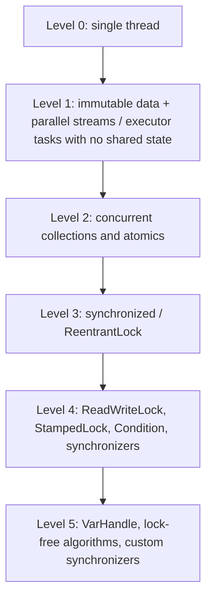

## 14.4 Golden rules

1. **Prefer immutability and confinement.** Shared mutable state is the root of almost all bugs.
2. **Prefer high-level tools** (`ExecutorService`, concurrent collections, `CompletableFuture`, virtual threads) to raw `Thread`, `wait`, `notify`.
3. **Guard every access** to shared mutable state with the same lock or mechanism.
4. **Keep critical sections small** and never do I/O or call unknown code inside them.
5. **Acquire locks in a fixed order**, or use `tryLock` with timeouts.
6. **Always use timeouts** on waits you do not fully control.
7. **Bound everything**: queues, pools, retries.
8. **Name your threads** and **shut down your pools**.
9. **Handle interruption** correctly; support cancellation.
10. **Separate CPU and I/O pools**; never block the common pool.
11. **Measure** (JMH, JFR) before optimizing, and **verify** with thread dumps.
12. **Document** thread-safety (`@GuardedBy`, Javadoc).

## 14.5 Suggested learning order

```mermaid
flowchart LR
    A["1. Threads, lifecycle, interrupt"] --> B["2. JMM: visibility, atomicity, happens-before"]
    B --> C["3. synchronized, volatile, wait/notify"]
    C --> D["4. Atomics, Locks, Conditions"]
    D --> E["5. Concurrent collections, BlockingQueue"]
    E --> F["6. Executors, Future, ThreadPoolExecutor"]
    F --> G["7. Synchronizers: latch, barrier, semaphore, phaser"]
    G --> H["8. ForkJoin, parallel streams"]
    H --> I["9. CompletableFuture, Flow"]
    I --> J["10. Virtual threads, structured concurrency, scoped values"]
    J --> K["11. Diagnostics, testing, patterns"]
```

---

# Part 15. Topic Coverage Checklist

Use this as a "did I miss anything?" index. Each item points to the section where it is explained.

**Foundations**
- [x] Process vs thread, concurrency vs parallelism vs asynchrony (1.1)
- [x] CPU-bound vs I/O-bound (1.2), Amdahl's law (1.3)
- [x] Safety, liveness, performance problem families (1.4)
- [x] Atomicity, visibility, ordering (1.4a)

**Memory model**
- [x] Java Memory Model, happens-before (2.1, 2.2)
- [x] Visibility and reordering (2.3, 2.4), safe publication, `this` escape (2.4)
- [x] Double-checked locking, holder idiom, enum singleton (2.4)
- [x] `long`/`double` tearing (2.5), memory barriers (2.6)

**Threads**
- [x] Thread lifecycle and states (3.1)
- [x] All ways to create threads, platform vs virtual builders (3.2)
- [x] `start` vs `run`, `join`, `sleep`, `yield`, `interrupt`, `holdsLock`, `onSpinWait` (3.3)
- [x] Interruption and cancellation (3.4)
- [x] Daemon threads (3.5), uncaught exception handlers (3.6)
- [x] Thread groups, priorities, shutdown hooks, `Timer`, removed `stop/suspend/resume` (3.7)
- [x] `ThreadLocal`, `InheritableThreadLocal`, `ScopedValue`, `ThreadLocalRandom` (3.8, 10.4)

**Safety tools**
- [x] `synchronized`, monitors, reentrancy (4.1)
- [x] `wait` / `notify` / `notifyAll` (4.2)
- [x] `volatile` (4.3)
- [x] Atomics, CAS, ABA, `LongAdder`, accumulators, field updaters, arrays (4.4)
- [x] `VarHandle` and memory access modes (4.5)
- [x] `ReentrantLock`, `Condition`, `ReadWriteLock`, `StampedLock`, `LockSupport`, AQS (4.6)
- [x] Lock ordering, striping, granularity, coarsening (4.6.6)
- [x] Immutability, records, defensive copies (4.7)
- [x] Thread confinement kinds (4.8)
- [x] Check-then-act, read-modify-write (4.9)
- [x] Lock-free, wait-free, non-blocking (4.10)

**Coordination**
- [x] `CountDownLatch`, `CyclicBarrier`, `Semaphore`, `Phaser`, `Exchanger` (5.1 to 5.5)
- [x] Condition and queues as coordination (5.6)

**Collections**
- [x] Legacy sync collections, synchronized wrappers (6.2)
- [x] `ConcurrentHashMap` and atomic methods (6.3)
- [x] Fail-fast vs weakly consistent vs snapshot iterators (6.4)
- [x] All blocking queues, `SynchronousQueue`, `DelayQueue`, `TransferQueue`, deques (6.5)
- [x] Copy-on-write, skip lists, concurrent queues (6.2, 6.6, 6.7)

**Executors**
- [x] `Executor`, `ExecutorService`, `ScheduledExecutorService` hierarchy (7.1)
- [x] `Runnable`, `Callable`, `Future`, `FutureTask` (7.2)
- [x] `Executors` factories (7.3), `ThreadPoolExecutor` internals, queues, rejection (7.4)
- [x] Pool sizing (7.5), `execute/submit/invokeAll/invokeAny` (7.6)
- [x] `CompletionService` (7.7), scheduling (7.8), shutdown (7.9), `ThreadFactory` (7.10)
- [x] Common mistakes (7.11)

**Fork/Join and parallel**
- [x] `ForkJoinPool`, tasks, work stealing, common pool, `ManagedBlocker`, `CountedCompleter` (8.1)
- [x] `invoke/invokeAll/submit/execute` (8.2)
- [x] Parallel streams and parallel array utilities, `Spliterator` (8.3, 8.4)

**Async**
- [x] `CompletableFuture`, `CompletionStage`, all method families, error handling (9.1 to 9.4)
- [x] `Flow` API, `SubmissionPublisher`, back-pressure (9.5)

**Modern Java**
- [x] Virtual threads, carriers, pinning, rules (10.1, 10.2)
- [x] Structured concurrency (preview) (10.3)
- [x] `ScopedValue` (10.4), version timeline (10.5)

**Problems**
- [x] Deadlock, livelock, starvation, priority inversion, lost wake-up (11.1 to 11.5)
- [x] Contention, false sharing, over-parallelization, leaks (11.6, 11.7)

**Practice**
- [x] Design patterns (Part 12)
- [x] Diagnostics tools, testing, review checklist (Part 13)
- [x] Decision tables, golden rules, learning path (Part 14)

---

## One-page summary

```
SHARE LESS            -> confinement, immutability, ThreadLocal, single-thread executor
SHARE SAFELY          -> volatile (flag) | atomics (counter) | synchronized/Lock (invariants)
                         ConcurrentHashMap | BlockingQueue | CopyOnWrite | ReadWrite/StampedLock
WAIT / SIGNAL         -> Condition, wait-notify | CountDownLatch | CyclicBarrier | Phaser
                         Semaphore | Exchanger | BlockingQueue
RUN IN PARALLEL       -> Virtual threads (I/O) | ThreadPoolExecutor (jobs) | ForkJoinPool (CPU, recursive)
                         ScheduledExecutorService (timed) | parallel streams (data-parallel)
COMPOSE ASYNC         -> Future | CompletableFuture | StructuredTaskScope | Flow
STOP / TIME OUT       -> interrupt | Future.cancel | orTimeout | tryLock(t) | shutdown/close
STAY ALIVE AND FAST   -> lock order | tryLock | bounded queues | right pool size | LongAdder
                         thread dumps | JFR | JMH | jcstress
```
